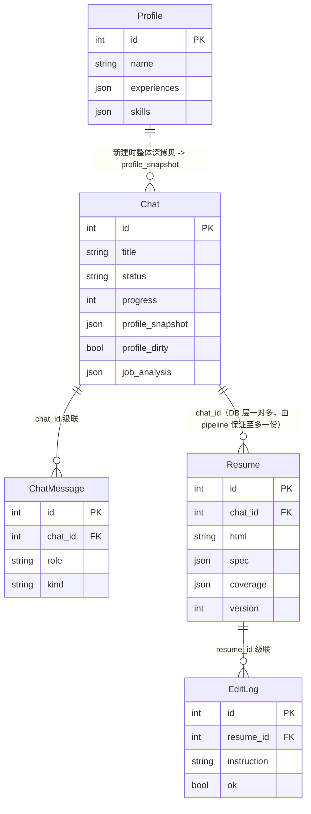

# 数据模型 / Data Model

> **这篇讲什么**：6 张表的逐字段说明、ER 关系、级联删除规则、`profile_snapshot` 的快照语义、`coverage` 的两档结构，以及幂等迁移机制。
> **适合谁读**：要改表结构、排查数据一致性、或需要理解「为什么删简历会连删对话」的后端开发者。
>
> 唯一权威来源：`backend/app/models.py`。本文所有字段与默认值均逐行核对过该文件。

---

## 1. ER 图



> **关于 `Chat ↔ Resume` 的基数（易误读）**
> **产品语义**是「一个 chat = 一份简历」，但 **DB 层是一对多**：`Resume.chat_id` 只是普通外键，没有唯一约束。
> 「至多一份」是由 `pipeline.run_chat()` 在生成时**删旧建新**维持的（`pipeline.py` 里先查 `existing` 再清理）。
> 因此代码里凡是按 chat 取简历的地方都做了**防御式读取**（如 `order_by(id.desc()).first()` 取最新一份），
> 删除时也是遍历删除。新增按 chat 查简历的功能时，请沿用这两种写法，不要假设只有一条。

> `AppSetting` 与其它表无外键关系，是独立的 key-value 配置表，未画入 ER 图。

---

## 2. 逐表说明

### 2.1 `Profile`（全局资料库，单份）

用户固定的简历素材库。结构化字段用 **JSON 列**承载，便于任意扩展。`Profile` 表只会有一条记录（`routers/profile.py::_get_or_create` 取 `order_by(id).first()`，没有就建一个空的）。

| 字段 | 类型 | 默认值 | 含义 |
|---|---|---|---|
| `id` | `int` | PK 自增 | |
| `name` | `str` | `""`（index） | 姓名 |
| `headline` | `str` | `""` | 一句话定位，如「5 年后端工程师」 |
| `email` | `str` | `""` | |
| `phone` | `str` | `""` | |
| `location` | `str` | `""` | 所在城市 |
| `age` | `int?` | `None` | 可空 |
| `avatar` | `str` | `""`（Text 列） | data-url 或外链 |
| `summary` | `str` | `""`（Text） | 个人简介 |
| `links` | `list[dict]` | `[]`（JSON） | `[{"label","url"}]` |
| `education` | `list[dict]` | `[]` | `[{"school","degree","major","start","end","gpa","highlights"}]` |
| `experiences` | `list[dict]` | `[]` | `[{"company","title","location","start","end","summary","achievements","tech"}]` |
| `projects` | `list[dict]` | `[]` | `[{"name","role","start","end","link","summary","highlights"}]` |
| `skills` | `list[dict]` | `[]` | `[{"name","level","category"}]` |
| `certificates` | `list[dict]` | `[]` | `[{"name","issuer","date"}]` |
| `languages` | `list[dict]` | `[]` | `[{"name","level"}]` |
| `awards` | `list[dict]` | `[]` | `[{"name","date","detail"}]` |
| `extra` | `dict` | `{}` | 无法归类的补充 |
| `created_at` / `updated_at` | `datetime` | `datetime.now()` | |

> 素材元素结构在 `schemas.py` 头部有权威注释，`mock.parse_resume_text` / `profile_import` 与之对齐。

### 2.2 `Chat`（聊天式工作区，由旧 `JobTask` 演进）

一个 chat = 一个求职场景 = 恰好一份简历；同时是**调度与并发的最小单位**。

| 字段 | 类型 | 默认值 | 含义 |
|---|---|---|---|
| `id` | `int` | PK | |
| `title` | `str` | `"新对话"` | 职位名/岗位名 |
| `source` | `str` | `""` | 岗位来源（JobStreet / 手动粘贴…） |
| `source_url` | `str` | `""` | |
| `raw_text` | `str` | `""`（Text） | 原始岗位要求（非结构化 JD） |
| `status` | `str` | `"draft"`（index） | 状态机：draft/queued/running/succeeded/failed/cancelled |
| `stage` | `str` | `""` | 当前阶段的人类可读描述 |
| `progress` | `int` | `0` | 0–100 |
| `error` | `str` | `""`（Text） | 最近错误 |
| `attempts` | `int` | `0` | 已尝试次数 |
| `max_retries` | `int` | `2` | 最大重试次数 |
| `profile_snapshot` | `dict` | `{}`（JSON） | **per-chat 资料整体快照**（见 §4） |
| `profile_dirty` | `bool` | `False` | 快照是否被 chat 内修改过（见 §4） |
| `job_analysis` | `dict` | `{}`（JSON） | 岗位解析产物：`requirements` / `sections` / `employer_questions` |
| `created_at` / `updated_at` | `datetime` | `now()`（index on created_at） | |
| `started_at` / `finished_at` | `datetime?` | `None` | |

> **无 DB CHECK 约束**：合法取值由 API 入参层收敛（`schemas.ChatStatus`）。注释明确写了这一点。

### 2.3 `ChatMessage`（对话消息）

| 字段 | 类型 | 默认值 | 含义 |
|---|---|---|---|
| `id` | `int` | PK | |
| `chat_id` | `int` | FK→`chat.id`（index） | |
| `role` | `str` | `"user"` | user / assistant / system |
| `kind` | `str` | `"text"` | jd / text / notice / guidance |
| `content` | `str` | `""`（Text） | |
| `meta` | `dict` | `{}`（JSON） | 如 `{"resume_id":…}` / `{"type":"interview"}` |
| `created_at` | `datetime` | `now()`（index） | |

> `ChatMessage` 与 `EditLog` **语义正交**：前者是聊天流，后者是简历 HTML 的二次编辑历史。

### 2.4 `Resume`（简历，HTML 为唯一真相）

| 字段 | 类型 | 默认值 | 含义 |
|---|---|---|---|
| `id` | `int` | PK | |
| `chat_id` | `int?` | FK→`chat.id`（index，可空） | **单向关联** |
| `title` | `str` | `""` | |
| `theme` | `str` | `"ark"` | ark / endfield / exa / corporate |
| `html` | `str` | `""`（Text） | **唯一真相来源**（自包含，含内联 `<style>`） |
| `spec` | `dict` | `{}`（JSON） | 生成时的结构快照 |
| `coverage` | `dict` | `{}`（JSON） | 覆盖清单 `{"coverage":[…],"summary":{…}}`（见 §5） |
| `version` | `int` | `1` | 每次保存/重排版/重生成 +1 |
| `created_at` / `updated_at` | `datetime` | `now()` | |

### 2.5 `EditLog`（AI 二次编辑记录）

| 字段 | 类型 | 默认值 | 含义 |
|---|---|---|---|
| `id` | `int` | PK | |
| `resume_id` | `int` | FK→`resume.id`（index） | |
| `instruction` | `str` | `""`（Text） | 用户指令（或「重新生成」） |
| `scope` | `str` | `"whole"` | whole / section |
| `target` | `str` | `""` | 局部编辑时的 section id |
| `ok` | `bool` | `True` | 编辑是否成功 |
| `error` | `str` | `""`（Text） | 失败原因 |
| `before_html` / `after_html` | `str` | `""`（Text） | 回退依据 |
| `created_at` | `datetime` | `now()` | |

### 2.6 `AppSetting`（运行时配置，覆盖 .env）

| 字段 | 类型 | 默认值 | 含义 |
|---|---|---|---|
| `key` | `str` | PK | 如 `llm_provider_id` / `llm_base_url` / `llm_api_key` / `llm_model` / `llm_temperature` / `worker_count` / `llm_max_tokens` |
| `value` | `str` | `""`（Text） | |
| `updated_at` | `datetime` | `now()` | |

> 读写在 `llm.get_runtime_config` / `llm.set_runtime_config`；`set_runtime_config` 对 `None` 值跳过（语义：「不传该字段=保持不变」）。

---

## 3. 关系与级联删除

### 3.1 `DELETE /api/chats/{chat_id}` 级联删什么

`routers/chats.py::_cascade_delete_chat` 按顺序删除：

1. 该 chat 的 **所有 Resume**；
2. 每个 Resume 的 **所有 EditLog**（先 `flush` 再删 Resume，避免外键约束失败）；
3. 该 chat 的 **所有 ChatMessage**；
4. **Chat 本身**。

**运行中/排队中拒绝**：`delete_chat` 若 `chat.status in ("running","queued")` → **400**「对话正在生成中，请先取消后再删除」。

### 3.2 `DELETE /api/resumes/{resume_id}` 为什么同时删 chat

`routers/resumes.py::delete_resume` 注释写得很明确：

> Chat 与简历是「一对一单元」：删简历时**同时删除关联 Chat**（与「删 Chat 级联删简历」对称，避免出现「成功却没有简历」的不一致状态）。

顺序：先删 EditLog → 删 Resume → 若 `r.chat_id` 存在则删该 chat 的 ChatMessage → 删 chat。**单向关联（`Resume.chat_id`）下只需单向处理**，不再需要旧模型「先置空 `resume_id` 再删」的绕外键代码。

### 3.3 兼容层 `/api/tasks/{id}` 的删除语义差异

`routers/tasks.py::delete_task` 多一个 `cascade` 参数：

- 运行中 → 400；
- 已生成简历且 `cascade=False` → **409**（提示前端确认后用 `cascade=true` 重试）；
- `cascade=True` 或无关联简历 → 删除。

---

## 4. `profile_snapshot` 与 `profile_dirty`

### 4.1 为什么是「整体快照」而非增量 diff

- **决策**：新建 chat 时对**全局 Profile 整体深拷贝**（`chats._global_profile_dict` → `Chat.profile_snapshot`）；chat 内修改只改本 chat 的快照。
- **为什么**：chat 是「冻结的工作上下文」。用户为 A 岗位补了 K8s 经历，不该污染 B 岗位的简历素材；反过来，用户在「资料」页改了全局资料，也不该悄悄改变已存在的历史对话的生成依据。增量 diff 会让「当前生效的完整资料 = 全局 ⊕ 本 chat 的所有 patch」变得需要重放，且 patch 序列一旦损坏就无法还原。
- **代价**：每个 chat 存一份完整资料的冗余副本。对本地单用户场景可忽略。
- **重置入口**：`POST /api/chats/{id}/profile/reset` 把快照重置为**当前**全局 Profile，并把 `profile_dirty` 置回 `False`。

### 4.2 `profile_dirty` 的含义

- `False`：快照与全局资料一致（新建时的样子，或刚 reset 过）。
- `True`：快照被本 chat 修改过。目前有 **3 个写入点**（均在 `routers/chats.py`）：
  1. `PUT /api/chats/{id}/profile` —— 手动编辑快照；
  2. `POST /api/chats/{id}/interview/submit` —— AI 问答的回答被合并进快照；
  3. `POST /api/chats/{id}/profile/import-text` —— 在工作区粘贴简历原文、解析后增补进快照。

前端 `chat.js::renderProfileBar` 据此显示「已单独调整」徽标（`#ws-profile-badge`）。

### 4.3 快照 → 生成用 dict 的归一化

- 新建时 `_profile_to_dict(Profile)` 产出 dict；
- 生成时 `_profile_from_snapshot(snapshot)` **补齐缺键**：标量空缺补 `""`、列表非 list 补 `[]`、`extra` 非 dict 补 `{}`。避免历史快照缺字段时渲染/keyerror。

---

## 5. `Resume.coverage` 的 JSON 结构

`coverage` 落库形状（`pipeline._normalize_coverage` 产出）：

```jsonc
{
  "coverage": [
    {
      "req_id": "R1",                         // 对应 requirements[].id
      "requirement": "3 年以上 Python 后端开发经验",
      "section": "Requirements",              // 该需求来自哪个分节
      "resume_evidence": "工作经历·ACME：5 年 Python 后端…",
      "source": "grounded",                   // 只有 grounded | capability 两档
      "evidence_ref": "experiences[0].achievements[0]",  // grounded 必填
      "note": ""
    }
  ],
  "summary": { "total": 8, "grounded": 6, "capability": 2, "uncovered": 0 }
}
```

### 两档语义与硬约束

| `source` | 语义 | 硬约束 |
|---|---|---|
| `grounded` | 来自资料**真实经历**，可在资料中溯源 | **必须有 `evidence_ref`**，否则强制降级为 `capability`（`_normalize_coverage` 里的硬规则：`if source=="grounded" and not evidence_ref: source="capability"`） |
| `capability` | 资料无直接对应，只写「具备…能力 / 可快速上手…」这类能力层面表述 | **严禁**编造公司名、年限、项目名、数字、学历、证书 |

### 兜底与统计

- **不得漏条**：`requirements` 中未被覆盖的条目，`_normalize_coverage` 会**自动补一条 `capability`**，`note = "资料中无直接对应经历，按能力层面表述"`，并把 `uncovered` 计数加一（`uncovered` 表示「兜底补出来的条数」，不是「缺口」）。
- **去重**：`req_id` 重复的条目会被跳过；`source` 白名单之外的值按有无 `evidence_ref` 推断。
- **`evidence_ref` 约束**：格式为指向资料具体项的路径字符串（`experiences[i].achievements[j]` / `skills[i]` / `projects[i]` / `education[i]`）。mock 模式下由 `mock._find_evidence_ref` 生成，LLM 模式下由提示词 `COVERAGE_CONTRACT` 要求模型填写。
- **绝不进正文**：`run_chat` 把 `coverage` / `coverage_summary` 从 spec 中 pop 出来存进 `Resume.coverage`；`renderer.render_resume_html` 还会再防御性剔除一次，保证即使误塞也不会出现在简历正文。

**API 出口**：`GET /api/chats/{id}/coverage`（→ `CoverageOut`）；前端 `resume.js::renderCoverage` 渲染成「有据 / 能力」徽标 + 出处 + 说明。

---

## 6. 迁移机制（`app/migrate.py`）

`db.init_db()` 在 `SQLModel.metadata.create_all(engine)` 之后调用 `migrate.run()`。因为 **`create_all` 只建缺失的表、不会修改已存在的表结构**，旧库的改名/加列必须显式迁移。

### 6.1 迁移步骤（幂等）

1. **`_migrate_resume_schema`**：若 `resume` 表仍是旧结构（有 `task_id`、无 `chat_id`）→ **重建** `resume` 表：
   - `task_id` 的值搬到 `chat_id`；
   - 新增 `coverage` 列；
   - 外键目标从 `jobtask(id)` 修正为 `chat(id)`；
   - `INSERT ... SELECT` 搬数据 → `DROP` 旧表 → `RENAME` → 建 `ix_resume_chat_id` 索引。
   - 若已是新结构但缺 `coverage` 列（手工改过表）→ 只 `ALTER TABLE ADD COLUMN coverage`。
2. **`_migrate_jobtask_to_chat`**：存在旧表 `jobtask` 且 `chat` 表为空 → 逐行搬为 `Chat`：
   - `profile_snapshot` 取**迁移当刻的全局 Profile 深拷贝**（旧库未存快照，**无法还原原始生成时点**——迁移日志会明确说明这一点）；
   - 补 `created_at` / `updated_at`；
   - 为每条旧任务补一条 `ChatMessage(kind="jd", role="user", content=raw_text)`；
   - 最后**无条件 `DROP TABLE jobtask`**。
3. **无旧数据时整个迁移是 no-op**（`_table_exists` 判断）。

### 6.2 幂等性保障

- 每步都以「列是否存在 / 表是否存在」作为幂等门（`if "chat_id" in cols: return`）。
- `SQLModel.metadata.create_all(engine)` 先建新表（`chat` / `chatmessage`），再迁移。
- 连接用 `sqlite3.connect(db_path, isolation_level=None)`（autocommit，便于 PRAGMA / DDL），并在迁移期间 `PRAGMA foreign_keys=OFF`（重建表、丢弃被引用的 `jobtask` 时避免约束报错）；迁移完成后连接事件会重新开启外键（`db._set_sqlite_pragma`）。
- 非 SQLite / 内存库直接 return（`_db_path()` 返回 `None`）。

### 6.3 `jobtask → chat` 兼容层

- 由 `DB` 层完成数据搬迁；由 `TaskStatus = ChatStatus`（`schemas.py`）与 `routers/tasks.py` 完成**接口层**兼容。
- 手动入口：`python -m app.migrate`（幂等安全）；`python -m app.migrate --fresh`（**会删光全部表重建，丢失全部数据**，仅确认不需要旧数据时使用）。

---

## 7. 常见陷阱

1. **删简历会连删对话**：`DELETE /api/resumes/{id}` 会同时删除 `r.chat_id` 指向的 chat。前端 `resume.js::deleteResume` 的确认文案已提示「删除简历会同时删除对应的对话记录」。
2. **`uncovered` 不是「未覆盖的缺口数」**：它是兜底补齐的 `capability` 条数。真正的「缺口」由生成前的 AI 问答（`interview`）用关键词重合度找。
3. **`profile_snapshot` 是深拷贝的整体副本**：改 chat 内资料不影响全局；但如果忘了 `reset`，用户会以为「资料页改了却没生效」——因为生成读的是**快照**而非全局。
4. **迁移无法还原旧数据的原始生成时点**：`jobtask → chat` 时 `profile_snapshot` 用的是迁移当刻的全局资料，不是任务创建时的资料。这是旧库的结构性缺陷，日志会明确说明。
5. **JSON 列没有 schema 校验**：`profile_snapshot` / `job_analysis` / `coverage` 都是裸 JSON，脏数据只会在下游 `_normalize_*` / `_profile_from_snapshot` 处被兜底，而不是入库时报错。

---

**相关文档**：[系统总览](./overview.md) · [生成管线](./pipeline.md) · [任务调度器](./scheduler.md) · [API 参考](../03-api/reference.md)
