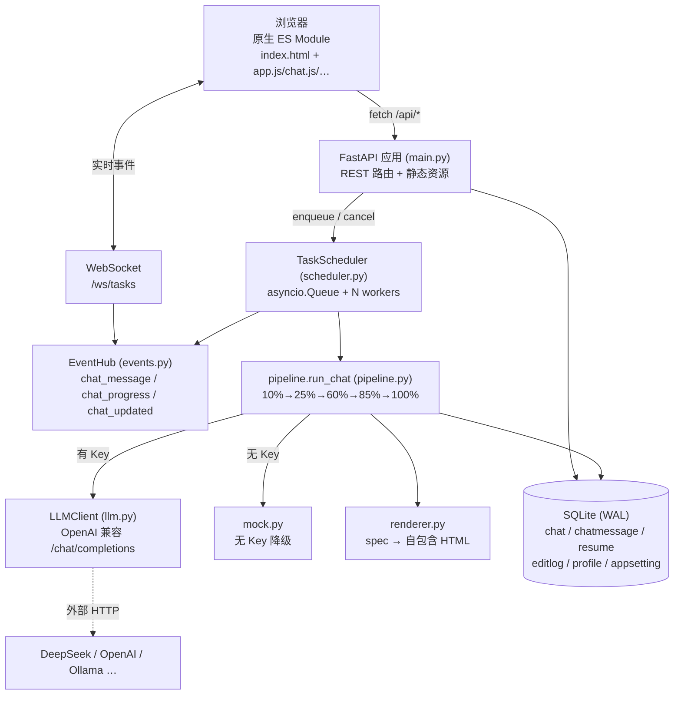
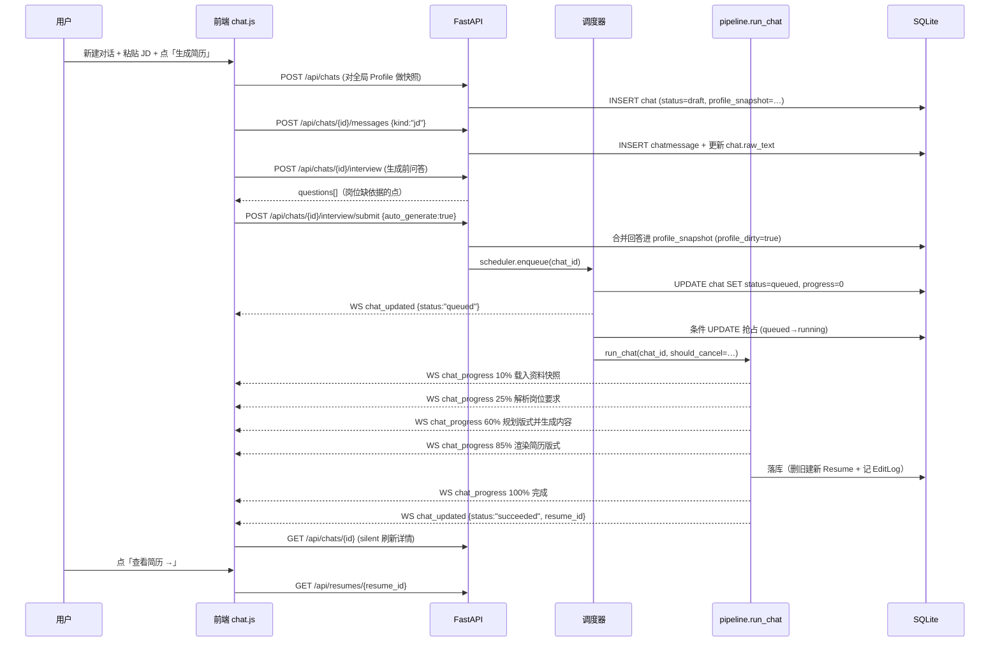

# 系统总览 / Overview

> **这篇讲什么**：把「一个 chat = 一个求职场景 = 恰好一份简历」这套系统的全貌讲清楚——技术选型、组件关系、端到端数据流、目录职责、关键设计决策。
> **适合谁读**：刚加入项目、需要 30 分钟内建立系统心智模型的开发者。

---

## 1. 一句话定位

**AI Resume Generator** 是一个**本地优先、聊天式**的求职简历工作台：把招聘岗位的 JD 粘进一个对话，系统先解析岗位、再基于你的固定资料生成一份针对性简历，并给出「哪条要求有据可依、哪条只能按能力表述」的覆盖清单。

- 后端： **FastAPI + SQLModel + SQLite(WAL) + asyncio 调度器**
- 前端： **原生 ES Module（无构建工具）**，三个视图：`01 资料` / `02 工作区` / `03 简历`
- 运行：本机单进程，数据不出本机；**无 API Key 时自动进入 mock 降级模式**，开箱即可端到端跑通。

---

## 2. 技术选型表

| 层 | 选型 | 选它的理由 |
|---|---|---|
| Web 框架 | **FastAPI** | 原生 async（与 asyncio 调度器同栈）、Pydantic 校验、路由分组清晰；`Depends(get_session)` 注入简化事务。 |
| ORM / 数据 | **SQLModel** | 同时是 Pydantic 模型与 SQLAlchemy 表，`schemas.py` 与 `models.py` 心智统一；JSON 列直接映射 `dict` / `list`。 |
| 数据库 | **SQLite + WAL** | 零外部依赖、单文件、本地优先；`PRAGMA journal_mode=WAL` + `check_same_thread=False` 让请求线程与后台 worker 共享同一连接文件。 |
| 并发调度 | **asyncio.Queue + worker + 条件 UPDATE 抢占** | 免 Celery/Redis；队列只是触发器，**DB 里的 `status` 才是真相来源**，因此可重启恢复。 |
| LLM 接入 | **httpx + OpenAI 兼容 `/chat/completions`** | 一套客户端可指向 DeepSeek / OpenAI / Moonshot / 通义 / 智谱 / Ollama 等（见 `providers.py`）。 |
| 模板渲染 | **Jinja2（autoescape）** | 模型只产出 spec JSON，HTML 由确定性渲染器产出 → XSS 防线 + 样式一致。 |
| HTML 净化 | **nh3（Rust ammonia 绑定）** | 白名单净化，堵死手写正则堵不完的变体（见 [security.md](./security.md)）。 |
| 前端 | **原生 ES Module** | 无构建工具、无依赖树，双击即跑；~4200 行体量可控。 |
| 前端配色 | **Ark UI 家族 / moderate 深度** | 近黑底 + 青色信号 + 方角 + 1px 细线 + 等宽字体承载技术信息（见 [design-system.md](../04-frontend/design-system.md)）。 |

---

## 3. 组件图



---

## 4. 端到端数据流：从粘贴 JD 到产出简历



---

## 5. 目录结构树（`backend/app/`）

```
backend/app/
├── __init__.py          包标记
├── config.py            环境变量 / .env 配置（Settings + lru_cache 单例）
├── db.py                引擎 + WAL/synchronous/foreign_keys PRAGMA + session_scope + init_db
├── models.py            SQLModel 表定义：Profile/Chat/ChatMessage/Resume/EditLog/AppSetting
├── schemas.py           Pydantic 请求/响应模型 + 枚举（ChatStatus/ThemeId/LayoutId…）
├── migrate.py           幂等迁移：jobtask→chat、resume.task_id→chat_id、补 coverage
├── main.py              FastAPI 入口：lifespan 建表+启动调度器、挂载路由/WS/静态
├── events.py            EventHub：WebSocket 客户端集合 + 广播
├── scheduler.py         TaskScheduler：asyncio.Queue + worker + 条件 UPDATE 抢占 + 重启恢复
├── pipeline.py          run_chat()：单个 chat 的生成流水线 + 规范化
├── prompts.py           SYSTEM_* 提示词 + SPEC_CONTRACT / COVERAGE_CONTRACT
├── llm.py               LLMClient + 运行时配置（DB 覆盖 env）+ JSON 容错解析
├── providers.py         供应商预设注册表（DeepSeek 默认）/ base_url 反查 / is_local_url
├── mock.py              无 Key 时的启发式降级（分析 / 生成 / 编辑 / 简历解析）
├── renderer.py          spec → 自包含 HTML；build_preview_document（含 CSP）
├── sanitize.py          nh3 白名单净化（AI 二次编辑产物入库前）
├── interview.py         AI 问答（flashcard）：生成问题 / 增量合并回答
├── fetch.py             URL 抓取 + 正文抽取 + JD 抽取（LLM 优先）
├── profile_import.py    粘贴简历文本 → 结构化资料（LLM 优先 / 启发式回落）+ 只增补合并（merge_profiles）
└── routers/
    ├── profile.py       /api/profile（含 /interview、/import-text）
    ├── chats.py         /api/chats（CRUD、快照、消息、生成、覆盖清单、导入、粘贴简历增补）
    ├── resumes.py       /api/resumes（查询、保存、重排版、预览、下载、删除）
    ├── ai_edit.py       /api/resumes/{id}/ai-edit | edits | undo
    ├── settings.py      /api/settings（LLM 设置、provider 预设、测试连接）
    └── tasks.py         /api/tasks（deprecated 兼容层，内部映射到 Chat）
```

前端（`backend/app/static/`）：

```
static/
├── index.html           三视图外壳 + 5 个 dialog + 内联防闪烁脚本 + ?v=N 版本号
├── css/app.css          Ark UI token（:root / :root[data-theme="light"]）+ 全部样式
└── js/
    ├── app.js           入口：视图路由、设置弹窗、命令面板、快捷键、主题
    ├── api.js           REST 封装 + WebSocket 订阅 connectEvents()
    ├── chat.js          工作区：对话状态所有者、WebSocket 收敛、生成主流程
    ├── profile.js       资料库表单 + 可重复条目 + 头像 + 导入导出
    ├── resume.js        简历工作台：WYSIWYG / 源码 / AI 修改 / 版式 / 匹配分析
    ├── interview.js     AI 问答弹窗（资料页 / 工作区共用）
    └── ui.js            DOM 助手 el/$/$$、toast、fmtTime、statusLabel
```

---

## 6. 关键设计决策清单

> 每条格式：**决策** → 为什么 → 代价。

### D1. 一个 chat = 一个求职场景 = 恰好一份简历

- **决策**：以 `Chat` 为调度与并发的最小单位，`Resume.chat_id` 一对一。
- **为什么**：不做「一个 JD 一个任务」的批量模型。批量模型下 N 个岗位会散落成 N 个无上下文的条目，用户无法为**某个岗位单独微调资料**（例如该岗位强调 K8s，你就想在这个场景补一段集群经历）。chat 天然是一个「冻结的工作上下文」——它持有自己的 `profile_snapshot`。
- **代价**：不能一次为多个岗位并发产简历（`/api/tasks/batch` 是兼容层保留的能力，但主流程已收敛到单选）。核心逻辑由旧 `JobTask` 机械重命名而来，调度器 100% 复用（见 `scheduler.py` 头部注释）。

### D2. 模型输出 spec JSON，而非 HTML

- **决策**：`pipeline.run_chat` 让模型产出**结构化 spec**（`header` / `sections` / `match_notes` / `coverage`），HTML 由 `renderer.render_resume_html` 确定性生成。
- **为什么**：
  1. **XSS 防线**：所有用户/模型文本经 Jinja2 autoescape 转义，模型无法注入可执行标记。
  2. **零 LLM 成本重排版**：`POST /api/resumes/{id}/layout` 基于保存的 `spec` 重渲染，切换版式不消耗 token。
  3. 样式一致、可编辑、可打印。
- **代价**：模型必须严格遵守 `SPEC_CONTRACT`；`_normalize_spec` 要做大量字段兜底，否则渲染器吃不动。

### D3. HTML 是简历的唯一真相来源

- **决策**：`Resume.html` 是渲染与导出的唯一来源；`spec` / `coverage` 只是生成时的快照与元数据。
- **为什么**：用户可以在工作台所见即所得地改 HTML，`PUT /api/resumes/{id}` 保存的也是 HTML。若把 spec 当真相，用户的手改会在下次 re-render 时丢失。
- **代价**：spec 与 html 可能不一致；因此「应用版式」会同时更新 spec 并重渲染 html（`change_layout` 里 `r.spec = spec; r.html = render_resume_html(spec)`），是唯一允许二者分叉后重新对齐的入口。

### D4. `Resume.chat_id` 单向关联（删掉 `Chat.resume_id`）

- **决策**：只保留 `Resume.chat_id`；`Chat` 列表所需的 `resume_id` **由查询左连派生**（`chats._resume_id_for`），不再存储。
- **为什么**：双向引用会带来「删库绕外键」的代码——旧模型要「先置空 `resume_id` 再删」。单向关联下，删 Chat 就级联删 Resume（`_cascade_delete_chat`），删 Resume 就反向删 Chat（`resumes.delete_resume`），只需单向处理。
- **代价**：列表接口每条 chat 多一次派生查询（`select(Resume).where(chat_id==…).order_by(id.desc()).first()`），换取代码简单。

### D5. 重新生成 = 覆盖，但记 EditLog 以便回退

- **决策**：再次生成时，`run_chat` 删除该 chat 已有 Resume（连同其 EditLog），插入新 Resume，`version = prev_version+1`；若存在旧 html，额外写一条 `EditLog(instruction="重新生成", before_html=old, after_html=new)`。
- **为什么**：一个 chat 恰好一份简历，不能堆 N 份；但用户可能后悔，所以留下可回退的一版历史，前端「回退上一版」据此救回。
- **代价**：只有「上一版」可回退，不做完整版本树；每次重新生成都会删除旧 EditLog（历史不累积）。

---

## 7. 常见陷阱

1. **别在 `pipeline` 里 `import scheduler`**：会形成 `pipeline ↔ scheduler` 循环导入。取消检查通过注入的 `should_cancel` 回调完成（见 [pipeline.md](./pipeline.md)）。
2. **`chat_id` 不等于 `resume_id`**：前端 `chat.js` 用 `chat.id`，`resume.js` 用 `resume.id`，二者永远不同，误用会 404。
3. **进度不是单调递增的进度条承诺**：失败重试会把 `status` 改回 `queued` 且**同步把 `progress` 归零**，前端进度条会「倒退」，这是刻意的（见 [scheduler.md](./scheduler.md) 不变式）。
4. **WebSocket 路径仍是 `/ws/tasks`**：事件名已改为 `chat_*`，但路径因兼容未改（`main.py`）。前端 `api.connectEvents` 也连这个路径。
5. **`/api/tasks*` 标了 `deprecated` 但有意保留**：5 个 HTTP 级测试（smoke / regression / progress_probe / xss_probe / e2e_verify）依赖它做安全网，见 [reference.md](../03-api/reference.md)。

---

**相关文档**：[数据模型](./data-model.md) · [生成管线](./pipeline.md) · [任务调度器](./scheduler.md) · [安全设计](./security.md) · [API 参考](../03-api/reference.md) · [前端模块](../04-frontend/modules.md) · [设计系统](../04-frontend/design-system.md) · [可视化版](./overview.html)
