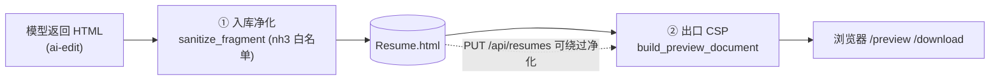

# 安全设计 / Security

> **这篇讲什么**：简历系统里 HTML 会**同源返回**（预览/下载），因此是存储型 XSS 的高危面。本文讲清两层防线（入库净化 + 出口 CSP）、为什么禁止手写正则、nh3 的配置坑、CSP 细节，以及抓取侧的输入校验。
> **适合谁读**：要改净化器、CSP、渲染器或抓取逻辑的开发者；做安全评审的人。
>
> 权威来源：`backend/app/sanitize.py`、`backend/app/renderer.py`、`backend/app/routers/ai_edit.py`、`backend/app/fetch.py`、`backend/tests/xss_probe.py`。

---

## 1. 威胁模型

简历 HTML 会被 `/api/resumes/{id}/preview`（`HTMLResponse`）与 `/download`（`text/html`）**以完整文档、同源返回**。凡是能进入 `Resume.html` 的恶意标记，都会在用户打开预览时执行 → **存储型 XSS**。

两个输入端：
1. **生成阶段**：模型按 `spec` 产出，HTML 由 `renderer` 用 Jinja2 `autoescape` 转义 → 天然安全。
2. **AI 二次编辑**：`ai_edit.py` 把模型返回的 `html` **当作可信 HTML**（这是用户显式发起的编辑）→ **必须净化后才能入库**。

---

## 2. 两层防线



- **① 入库净化（`sanitize.sanitize_fragment`）**：只净化 **AI 编辑产物**（`ai_edit.py` 在写库前调用）。生成阶段的 HTML 由 autoescape 保证，不经过它。
- **② 出口 CSP（`renderer.build_preview_document`）**：所有把简历包成完整文档的入口（preview / download / 前端 print）都加一层严格 CSP。这是**架构级**保证——即便净化被绕过，注入的脚本也跑不起来（`xss_probe.py` 的 B 组用例正是模拟「净化被绕过、CSP 兜底」）。

---

## 3. 为什么禁止手写正则做 HTML 净化

`sanitize.py` 头部注释写得很直白：**正则做 HTML 净化堵不完**。实测（`xss_probe.py::PAYLOADS`）能绕过手写正则的变体：

| 变体 | payload | 为什么正则难堵 |
|---|---|---|
| `/` 分隔属性 | `` | 事件的 `on…` 与标签用 `/` 分隔，正则容易只匹配 `空格+on…` |
| SVG 事件 | `<svg/onload="…">`、`<svg/onload=alert(3)>` | 未闭合/自闭合写法多样 |
| 实体编码协议 | `<a href="jav&#x61;script:alert(4)">` | `javascript:` 被 `&#x61;`（=a）拆开 |
| 数字实体协议 | `<a href="&#106;avascript:alert(5)">` | 同上，十进制实体 |
| 分隔事件 | `<div/onclick="alert(6)">` | 同第一行 |

**结论**：必须用成熟库 **nh3**（Rust ammonia 的 Python 绑定）做**白名单净化**——它对所有标签统一剥离 `on*` 事件、危险协议与 `<script>`，无论属性怎么分隔、实体怎么编码。

---

## 4. nh3 配置与坑

`_ALLOWED_TAGS`（白名单，含 `style` / 表格 / 列表 / 代码等安全标签）、`_ALLOWED_ATTRS`（`class` / `style` / `data-*`；`img` 的 `src`/`alt`；`a` 的 `href`；`td/th` 的 `colspan/rowspan/scope`）、`url_schemes={"http","https","data"}`。

调用：

```python
clean = nh3.clean(
    html,
    tags=_ALLOWED_TAGS,
    attributes=_ALLOWED_ATTRS,
    url_schemes={"http", "https", "data"},
    clean_content_tags=_CLEAN_CONTENT_TAGS,   # = {"script"}
)
```

### 坑 1：`clean_content_tags` 只能放 `script`

`clean_content_tags` 语义是「**连标签内容一起删除**」（避免脚本内容残留成可见文本）。

- 放 `script` ✓（脚本内容不该显示）。
- **放 `style` ✗**：`style` 必须**保留**（简历排版靠内联 `<style>`），且 `style` 不能**同时**出现在 `tags` 与 `clean_content_tags`，否则 **nh3 会直接 panic**（`sanitize.py` 注释明确写此约束）。

### 坑 2：判定「是否移除了危险内容」不能用 `clean != html`

nh3 会做**规范化**（补 `rel`、调属性顺序等），用 `clean != html` 判断会**几乎每次误报**。正确做法：用**独立的轻量探测器** `_looks_dangerous`（正则 `_DANGEROUS_RE` 匹配 `<\s*script|iframe|object|embed|meta|link|on[a-z]+=|javascript:|vbscript:|data:text/html`，先 `html.unescape` 再匹配），它**仅用于驱动提示文案，不承担安全职责**。

### 坑 3：`<style>` 文本内容 nh3 不净化

nh3 不进入 `<style>` 的**文本内容**，因此 `@import` 外链可能残留（形成 IP/网络探测面）。补一道后处理 `_strip_imports`：只匹配 `<style>…</style>` 块内部，用 `_AT_IMPORT_RE` 剥离 `@import url(...)` / `@import "..."` 到分号；**不全局替换**（避免误删正文里的 `content:"@import x"`）。

### 返回契约

`sanitize_fragment(html) -> (clean_html, removed)`。`removed = _looks_dangerous(原) or import_hit`；`ai_edit.py` 据此把 `summary` 追加「（已自动净化模型输出中的不安全内容）」。

---

## 5. 出口 CSP（`renderer.build_preview_document`）

```html
<meta http-equiv="Content-Security-Policy"
      content="default-src 'none'; style-src 'unsafe-inline'; img-src data: https:; base-uri 'none'; form-action 'none'" />
```

| 指令 | 作用 |
|---|---|
| `default-src 'none'` | 默认禁止一切资源，简历本就不需要外部资源 |
| `style-src 'unsafe-inline'` | 允许内联 `<style>`（简历自带样式） |
| `img-src data: https:` | 允许 data-url 头像与外链图 |
| `base-uri 'none'` | 禁止 `<base>` 劫持相对 URL |
| `form-action 'none'` | 禁止表单外发 |

### 为什么**不加 `frame-ancestors`**

`build_preview_document` 注释：**meta CSP 不支持 `frame-ancestors`**，加上会产生控制台警告（且无效）。`/preview` 只在新标签页打开，不需要靠 CSP 防嵌套。

> **前端 `resume.js::printResume` 也内联了同一份 CSP**（写进 `window.open` 的新文档），保持打印视图与 `/preview` 一致。

---

## 6. 简历预览为什么必须用 iframe 隔离

- 简历 CSS 含**全局选择器**（`*{box-sizing}`、`html,body{margin:0}`、`@page`、`@media print` 等）。若直接内联进主应用 DOM，会**污染主界面样式**。
- `resume.js::setEditorHtml` 把简历片段塞进 `<iframe srcdoc>`（`#editor-frame`），并开启 `designMode="on"` 做所见即所得编辑。iframe 提供独立的文档/样式作用域。
- iframe `srcdoc` 里也对简历标题等用户输入做 `escapeHtml`（`printResume` 用 `escapeHtml(current.title)`），与后端 `build_preview_document` 的 `html.escape(safe_title)` 呼应。

---

## 7. 抓取侧的输入安全（`fetch.py`）

### 7.1 `validate_url` 必须先显式拒绝非 http(s) 再补前缀

```python
has_scheme = re.match(r"^[a-zA-Z][a-zA-Z0-9+.-]*://", u)
if has_scheme and not re.match(r"^https?://", u, re.I):
    raise FetchError("仅支持 http(s) 网页链接")   # 显式拒绝 file://、ftp:// 等
if not has_scheme:
    u = "https://" + u                              # 再补前缀
parsed = urlparse(u)
if parsed.scheme not in ("http","https") or not parsed.hostname:
    raise FetchError("链接格式不正确…")
```

**顺序很关键**：若先补 `https://` 再判断，`file:///etc/passwd` 会被误判；必须先识别「已带 scheme 但不是 http(s)」并显式拒绝。

### 7.2 `BROWSER_HEADERS` 为什么必须完整

`fetch.py` 注释：实测 **JobStreet 等站点只带 `User-Agent` 会返回 403（反爬）**，补齐 `Accept` / `Accept-Language` / `sec-ch-ua` / `sec-fetch-*` 等后才正常 200。因此 `BROWSER_HEADERS` 是一整组浏览器请求头，而非单个 UA。

其它抓取约束：静态抓取（不执行页面 JS）、超时 20s、响应体上限 `MAX_HTML_BYTES=2MB`、正文上限 `MAX_TEXT_CHARS=20000`；只接受 `text/html` 或 `text/*`；本机地址绕过代理（`trust_env=not is_local_url(url)`）。

---

## 8. 其它安全约定

- **LLM 出错信息脱敏**：`settings.py::test_llm` 注释明确「绝不把 api_key 写入日志或错误信息」；`LLMClient.chat` 的报错只含 `status_code` 与响应前 300 字符。
- **渲染器防御性剔除 coverage**：`render_resume_html` 先 pop 掉 `coverage` / `coverage_summary`，保证元数据不会误入正文。
- **`build_preview_document` 转义标题**：`safe_title = html.escape(title or "简历", quote=True)`（标题来自岗位名，是用户输入）。

---

## 9. 常见陷阱

1. **别用 `clean != html` 判断「是否净化了危险内容」**：nh3 会规范化，必然误报；用 `_looks_dangerous` 独立探测器。
2. **`clean_content_tags` 放 `style` 会 panic**：只能放 `script`；`style` 放 `tags` 保留。
3. **meta CSP 不支持 `frame-ancestors`**：加了无效且控制台告警，别加。
4. **`@import` 必须在 `<style>` 块内剥离**：全局替换会误删正文里当普通文本出现的 `@import`。
5. **`validate_url` 的判断顺序不能反**：先补 `https://` 会让 `file://` 漏网。抓取用的 `BROWSER_HEADERS` 缺一项就可能被反爬拦成 403。

---

**相关文档**：[系统总览](./overview.md) · [生成管线](./pipeline.md) · [API 参考](../03-api/reference.md) · [前端模块](../04-frontend/modules.md)
