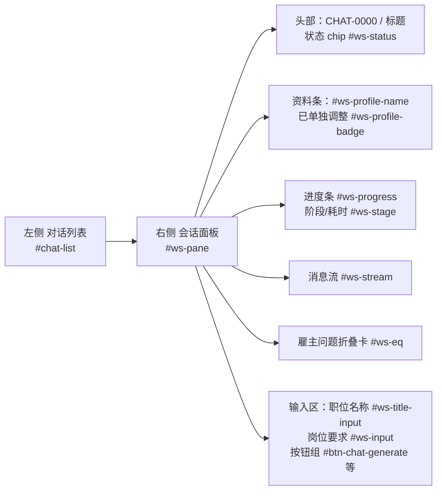
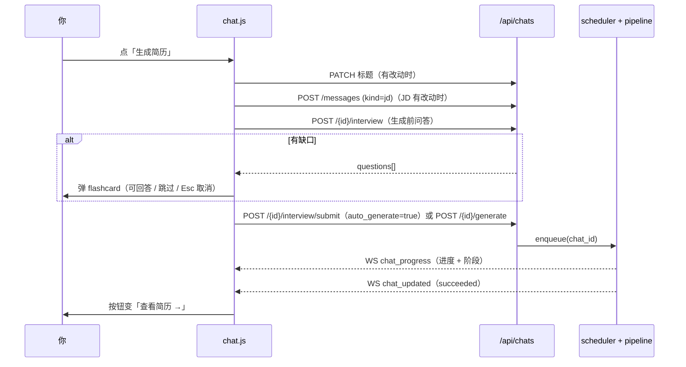

# 功能：聊天式工作区（`02 工作区`）

> 这篇讲工作区怎么用：一个对话如何对应一份简历、各界面元素与生成按钮的状态机、完整生成流程、以及取消/重试/删除的语义。
> 适合：使用者；要改工作区交互或生成流程的开发者。

实现：`backend/app/static/js/chat.js`（前端单一状态所有者）、`backend/app/routers/chats.py`（接口）、`backend/app/pipeline.py`（生成流水线）、`backend/app/scheduler.py`（调度）。

---

## 1. 核心理念：为什么是「一对话一简历」

工作区是整个系统的默认视图（左侧导航 `02 工作区`）。一个 chat = 一个求职场景 = **恰好一份简历**。

它替代了早期的「批量建任务」模型：旧模型里，你一次性粘一堆岗位、系统批量拆成多条任务并行跑，简历散落各处、和岗位的对应关系靠 `resume_id` 双向引用维护，删一个要写「先置空外键再删」的绕行代码。现在的模型把**一个岗位场景收敛成一个对话单元**：

- 一个对话自带一份**资料快照**（该场景专用），自带一段岗位要求（JD），只产出一份简历；
- 简历与对话的关联**单向**（只保留 `Resume.chat_id`），对话列表里的 `resume_id` 由查询左连派生，不再存储；
- 调度器把 chat id 当作调度键，队列/并发/重试/取消逻辑复用原有实现。

好处：语义清晰（一个场景一个单元）、状态可复现（快照冻结）、删除干净（级联删简历与消息）。

---

## 2. 界面元素

| 元素 | id | 说明 |
|---|---|---|
| 对话列表 | `#chat-list` | 按 `updated_at` 倒序；每条含标题、状态 chip、`CHAT-xxxx · 时间`；窄屏由 `#btn-toggle-chats` 折叠 |
| 新建对话 | `#btn-new-chat`（空态另有 `#btn-empty-new-chat`） | 新建后自动对全局资料做快照 |
| 从链接导入 | `#btn-import-url`（空态另有 `#btn-empty-import-url`） | 见 [url-import.md](./url-import.md) |
| 职位名称 | `#ws-title-input` | **可留空**：下方提示「可留空 —— 生成时会自动识别职位名称」。粘贴 JD 后会用本地启发式猜一个职位名回填（猜不到就不填） |
| 岗位要求（JD） | `#ws-input`（textarea） | 生成的前提；为空时生成会被拒绝（前端提示 + 后端 400） |
| 生成按钮 | `#btn-chat-generate` | 主操作，文案随状态变化（见 §3） |
| 重新生成 | `#btn-chat-regenerate` | 生成成功且字段未改动时出现 |
| 取消生成 | `#btn-chat-cancel` | 仅在 `queued` / `running` 时可见 |
| 重试 | `#btn-chat-retry` | 仅在 `failed` / `cancelled` 时可见 |
| 打开简历 | `#btn-chat-open-resume` | 已有简历时可见 |
| 删除 | `#btn-chat-delete` | 运行中不可删（见 §5） |
| 资料条 | `#ws-profile-name` / `#ws-profile-badge` / `#btn-chat-profile-edit` / `#btn-chat-profile-reset` | 见 [profile-library.md](./profile-library.md#4-全局资料-vs-对话快照) |
| 消息流 | `#ws-stream` | 气泡按 `role`、`kind` 渲染；长内容（> 480 字符）默认折叠，「展开全文」按钮切换 |
| 雇主问题 | `#ws-eq` / `#ws-eq-count` / `#ws-eq-list` | 来自岗位解析的「申请表问题」，**不进简历正文**，仅作准备参考 |

消息气泡的 `kind`：`jd`（岗位要求）、`text`（说明）、`notice`（提示，如生成完成）、`guidance`（指引，如问答记录）。气泡标注形如「你 · JD · 时间」「系统 · 提示 · 时间」。

---

## 3. 生成按钮状态机

`#btn-chat-generate` 始终可见，用**文案 + 禁用态**表达当前状态（`chat.js:updateComposerState`）：

| 状态 | 按钮文案 | 可点？ | 次级按钮 |
|---|---|---|---|
| 无内容（职位名与 JD 皆空） | 「生成简历」 | 禁用 | — |
| 有内容、未生成 | 「生成简历」 | 可点 | — |
| 点击后正在保存字段 | 「保存中…」 | 禁用 | — |
| 保存完、正在取问题 | 「准备问答…」 | 禁用 | — |
| 有缺口、等待你回答 | 「等待回答…」 | 禁用 | flashcard 弹窗中 |
| 已入队 / 生成中 | 「生成中…」 | 禁用 | 「取消生成」可见 |
| 生成成功且字段未改 | 「查看简历 →」 | 可点（打开简历） | 「重新生成」可见 |
| 生成成功但字段已改 | 「重新生成」 | 可点 | — |
| 失败 / 取消 | 「重新生成」 | 可点 | 「重试」可见 |

生成中会**锁定** `#ws-title-input` 与 `#ws-input`，避免编辑内容与正在跑的任务错位。按钮旁 `#ws-composer-status` 显示「生成中 · 阶段 · 已用时 Ns」等文案；`dataset.busy` 用于避免按钮卡在 loading。

---

## 4. 完整生成流程

有序步骤（`chat.js:generateChat` + `pipeline.run_chat`）：

1. **校验**：职位名与 JD 都空 → 提示；仅 JD 空 → 报「岗位要求为空：请先粘贴 JD 再生成」（后端也会 400）。
2. **保存字段**：标题有变 → `PATCH /api/chats/{id}`；JD 有变 → `POST /api/chats/{id}/messages`（`kind=jd`，同步写入 `Chat.raw_text`）。
3. **生成前问答**：`POST /api/chats/{id}/interview`。**只有查到缺口才弹卡片**；没有问题则直接进入下一步。
4. **入队**：回答了 → `POST /{id}/interview/submit`（`auto_generate=true`）；无缺口 → `POST /{id}/generate`。两者最终都走 `scheduler.enqueue`。
5. **流水线执行**（每步写进度并广播 `chat_progress`）：
   - 10% 载入资料快照（超长 JD 截断至 20000 字符；快照为空则报错停止）
   - 25% 解析岗位要求（分节 + `requirements` + `employer_questions`；必要时自动回填对话标题）
   - 60% 规划版式并生成内容 + 覆盖清单（LLM 或 mock）
   - 85% 渲染自包含 HTML
   - 100% 落库并广播 `chat_updated`
6. **落库**：一个 chat 只保留一份简历——删除该对话已有简历（连同其 `EditLog`），新建一份；若原来有简历，记一条 `EditLog(instruction="重新生成")` 以便「回退上一版」；追加一条 `notice` 消息「已生成简历：标题」。
7. **前端收尾**：收到 `succeeded` → toast「生成完成，可点击「查看简历 →」打开」→ 静默拉取详情 → 按钮切换。

事件（WebSocket `/ws/tasks`）：`chat_message`（新消息）、`chat_progress`（进度/阶段）、`chat_updated`（状态变化）。

---

## 5. 状态机与各状态的 UI 表现

| 状态 | 状态 chip 文案 | UI 表现 |
|---|---|---|
| `draft` | 草稿 | 新建未生成；显示资料条与输入区 |
| `queued` | 排队中 | 进度条出现（0%，阶段「排队中」）；「取消生成」可见；输入锁定 |
| `running` | 生成中 | 进度条推进（10→25→60→85→100%），阶段文案 + 「已用时 Ns」每秒刷新 |
| `succeeded` | 已完成 | 进度 100% / 阶段「完成」；按钮「查看简历 →」+「重新生成」；「打开简历」可见 |
| `failed` | 失败 | 进度条保留并显示错误文案；「重试」可见；错误也会写进 `#ws-stage` |
| `cancelled` | 已取消 | 阶段「已取消」；「重试」可见 |

- 状态 chip `#ws-status` 通过 `dataset.status` 着色；`statusLabel` 映射：queued→排队中、running→生成中、succeeded→已完成、failed→失败、cancelled→已取消。
- 左侧导航的 `#rail-badge-chats` 显示当前处于 `queued`/`running` 的对话数量。
- 失败重试由调度器自动进行：`attempts ≤ max_retries`（默认 2）时按 `retry_backoff * 2^(attempts-1)`（封顶 60s）退避重排；否则置 `failed` 并保留错误。

---

## 6. 取消 / 重试 / 删除

| 操作 | 入口 | 语义 |
|---|---|---|
| 取消 | `#btn-chat-cancel` → `POST /api/chats/{id}/cancel` | 把 `queued`/`running` 置为 `cancelled`；运行中的任务在下一个阶段检查点抛出 `TaskCancelled`，**不进入重试逻辑**；已在收尾窗口内的成功结果也不会覆盖成 cancelled |
| 重试 | `#btn-chat-retry` → `POST /api/chats/{id}/retry` | 清空 `attempts` 与 `error` 后重新入队；若正在运行/排队返回 409 |
| 删除 | `#btn-chat-delete` → `DELETE /api/chats/{id}` | 级联删除该对话的**简历 + 编辑记录 + 消息**；运行中/排队中返回 400（提示「对话正在生成中，请先取消后再删除」）；删除前有确认框（明确告知会一并删除简历） |
| 删除简历 | 简历工作台的 `#btn-delete-resume` | 与上面对称：删简历会**连带删掉关联对话**（一对一单元） |

---

## 【新功能】工作区直接粘贴简历原文

**目的**：省掉「切到资料页 → 打开导入弹窗 → 粘贴 → 回工作区」的往返。在对话里直接粘贴一份简历全文，即可解析并写入**本对话的资料快照**。

**怎么触发**：在已打开对话的工作区里，**直接 Ctrl+V 粘贴**一段简历文本（无需先点任何按钮）。

**判定条件（`chat.js:looksLikeResume`）**：粘贴内容需同时满足

- 长度 > 300 字符；且
- 命中简历小节特征（`RESUME_SECTION_RE`，如「工作经历 / 工作经验 / 项目经历 / 教育背景 / 专业技能 / 个人简介 / 自我评价 / 求职意向 / work experience / experience / education / projects / skills」等词）。

不满足则**保持默认粘贴行为**，不会误触发。另外，粘贴目标是 `#ws-title-input`（职位名称）或 `#ws-input`（岗位要求）时**不生效**（这两处的粘贴保留既有行为，含 JD 自动回填职位名）；命令面板输入框 `#cmd-input` 也排除（它有自己的一套逻辑）。

**交互流程**：

1. 命中后自动弹出确认弹窗 `#resume-paste-dialog`：标题「检测到简历文本」（`#rp-title`），正文提示「检测到简历文本，是否解析并写入本对话的资料？（只增补，不覆盖）」（`#rp-message`）；状态区 `#rp-status`。
2. 点「解析并写入」（`#btn-resume-paste-confirm`）→ 状态变「正在解析简历文本并写入本对话资料…」→ `POST /api/chats/{id}/profile/import-text`。
3. 成功：关闭弹窗，资料条刷新，toast「已解析并写入本对话资料：N 段经历 / M 项技能」；对话里新增一条 `notice` 消息，形如「已解析并写入本对话资料：2 段工作经历、10 项技能（只增补，不覆盖）」。
4. 点「取消」（`#btn-resume-paste-cancel`）→ 丢弃待处理文本，不调用接口。
5. 对话正在生成（`running`/`queued`）时，后端返回 409，界面提示「对话正在生成中，请稍后再导入资料」。

**语义（与资料页导入的关键差异）——只增补、不覆盖**：

- 解析复用与资料页相同的 `parse_profile_text`（LLM 优先，无 Key 回落启发式）；
- 合并走 `merge_profiles`：**标量字段已有非空值就保留，只填空缺**；列表字段按「身份键」去重后**追加**在原有条目之后；
- 结果写入 `Chat.profile_snapshot` 并把 `profile_dirty` 置 `True`（资料条出现「已单独调整」）；
- **不影响全局资料，也不影响其它对话**。

> 也就是说：资料页的「粘贴简历文本导入」是**整体覆盖**，工作区的「粘贴简历原文」是**只增补**。详见 [profile-library.md](./profile-library.md#31-只增补不覆盖语义存在于哪里)。

---

## 常见陷阱

1. **同一个 JD 问过一次就不再问了——这是预期行为**。生成前的问答会把你的回答**合并进本对话的资料快照**，缺口被补上后，再次对同一对话点生成就不会重复提问。想重新被追问，请「恢复默认」重置快照、或新建对话。
2. **切换对话 / 新建对话时若有未保存的输入会先弹确认**。`职位名称 / 岗位要求` 有改动时切换会提示「切换后将丢弃」，避免静默丢内容。
3. **职位名称不是必填**。留空时会自动识别并回填标题；粘贴 JD 后本地启发式也会尝试猜一个（猜不到不填）。不要为了「填满」而硬写。
4. **进展中的进度不是精确进度**。进度按阶段跳（10/25/60/85/100%），阶段文案比百分比更有参考价值；LLM 调用期间百分比可能长时间不动。
5. **删除是不可撤销的**，且会连带删除该对话的简历与编辑历史；运行中的对话必须先「取消生成」才能删除。
6. **再次生成 = 删旧建新**。旧简历会被删除（并留一条「重新生成」的编辑记录以便在简历工作台「回退上一版」）；若你在旧简历上做过 AI 修改但没保存成新版本，注意先确认。
