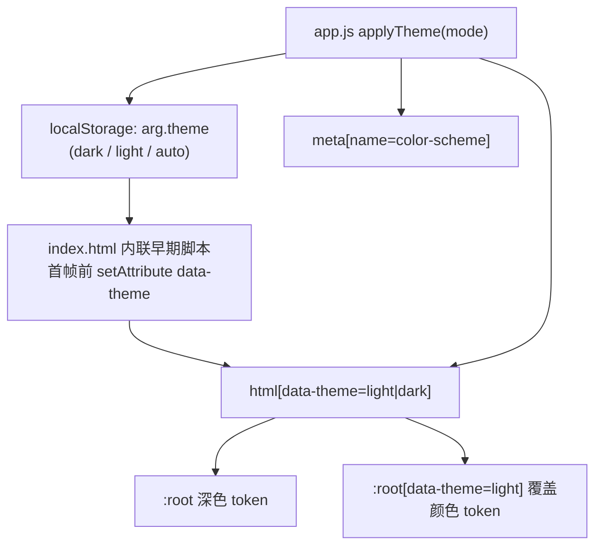

# 设计系统 / Design System

> **这篇讲什么**：Ark UI 家族的 `moderate` 深度规范、完整 token 表、颜色模式机制，以及必须遵守的约束（每条都对应踩过的坑）。
> **适合谁读**：要改样式、加颜色、调响应式的开发者；做 UI 评审的人。
>
> 权威来源：`backend/app/static/css/app.css`（token 定义在 `:root` 与 `:root[data-theme="light"]`）、`backend/app/static/index.html`。

---

## 1. Ark UI 家族与 `moderate` 深度

`index.html` 根元素：`<html lang="zh-CN" data-ark-theme="ark" data-ark-depth="moderate">`。

风格特征（`app.css` 头部注释）：

- **近黑底** `#080a0b` + **青色信号色** `#18d1ff`，工业信息系统质感。
- **方角**（`--radius: 0px`）、**1px 细线**（`--rule`）。
- **等宽数据字体**承载技术信息（`--font-mono`），显示字体（`--font-display`）用于品牌字。
- **章节索引**（如「CHAT-0004」「PF-01 / IDENTITY」「RESUME-0001」）、克制的方向性动效（`--t-direct` / `--t-reveal`）。
- 一层质感：蓝图底纹网格（`body::before` 用 `--grid-line` 画 46px 网格）。

`moderate` 深度含义：在本体色 + 结构线之上，**允许一层质感（网格底纹）与克制的方向性动效**，但不做重度发光/渐变堆砌。

---

## 2. 完整 token 表

### 2.1 语义色

| Token | 深色 `:root` | 浅色 `:root[data-theme="light"]` | 用途 |
|---|---|---|---|
| `--ink` | `#080a0b` | `#eef1f2` | 页面底色 / 输入框底 |
| `--surface` | `#0c1012` | `#fbfcfc` | 顶栏 / 面板底 |
| `--surface-2` | `#11171a` | `#e7ebed` | 次级面 / 输入聚焦底 |
| `--panel` | `rgba(18,24,27,0.72)` | `rgba(255,255,255,0.88)` | 半透明面板底 |
| `--panel-solid` | `#101619` | `#ffffff` | 实心面板底 |
| `--fg` | `#e9eef0` | `#10171a` | 正文 |
| `--fg-dim` | `#b3bcc0` | `#48535a` | 次级正文 |
| `--muted` | `#7b8589` | `#5d686d` | 弱化文字 |
| `--signal` | `#18d1ff` | `#0a7291` | **信号色**（强调 / 链接 / 主按钮） |
| `--signal-dim` | `#0f7f9c` | `#075c74` | 信号色弱态（禁用按钮） |
| `--state` | `#c8eb21` | `#546f00` | 成功 / 状态（黄绿） |
| `--danger` | `#ff5a5a` | `#c62828` | 危险 |
| `--warn` | `#ffb454` | `#9a5600` | 警告 |
| `--rule` | `rgba(233,238,240,0.10)` | `rgba(16,23,26,0.20)` | 1px 细分隔线 |
| `--rule-strong` | `rgba(233,238,240,0.24)` | `rgba(16,23,26,0.30)` | 强分隔线 / 输入框边 |

### 2.2 叠加层（tint）

> `app.css` 注释：原本是硬编码 `rgba(255,255,255,*)` 与 `rgba(24,209,255,*)`，浅色模式下会失效，故统一 token 化。

| Token | 深色 | 浅色 | 用途 |
|---|---|---|---|
| `--tint-soft` | `rgba(255,255,255,0.03)` | `rgba(16,23,26,0.035)` | 极淡：卡片底、输入框底 |
| `--tint-hover` | `rgba(255,255,255,0.06)` | `rgba(16,23,26,0.075)` | hover / 选中底 |
| `--tint-strong` | `rgba(255,255,255,0.12)` | `rgba(16,23,26,0.18)` | 滚动条滑块等 |
| `--grid-line` | `rgba(255,255,255,0.022)` | `rgba(16,23,26,0.05)` | 蓝图底纹网格线 |
| `--signal-tint` | `rgba(24,209,255,0.06)` | `rgba(10,114,145,0.10)` | 信号色淡底（顶栏渐变） |
| `--signal-tint-strong` | `rgba(24,209,255,0.14)` | `rgba(10,114,145,0.16)` | 信号色强底 |
| `--on-signal` | `#04181f` | `#ffffff` | 信号色背景之上的文字 |
| `--state-tint` | `rgba(200,235,33,0.045)` | `rgba(95,125,0,0.08)` | 成功 / 状态底 |
| `--state-glow` | `rgba(200,235,33,0.45)` | `rgba(95,125,0,0.35)` | 保存指示器呼吸光圈 |
| `--danger-tint` | `rgba(255,90,90,0.05)` | `rgba(198,40,40,0.07)` | 危险淡底 |
| `--scrim` | `rgba(4,8,10,0.78)` | `rgba(16,23,26,0.45)` | 弹窗遮罩 |
| `--signal-hover` | `#4fdcff` | `#075a75` | 主按钮 hover 底色（浅色需更深，否则白字看不清） |
| `--on-signal-dim` | `rgba(4,24,31,0.6)` | `rgba(255,255,255,0.6)` | 主按钮 disabled 文字色 |
| `--paper` | `#ffffff` | `#ffffff` | 简历预览「纸张」底：**与主题无关**，始终为白 |
| `--muted-soft` | `rgba(123,133,137,0.7)` | `rgba(93,104,109,0.8)` | 占位符 / 弱化文字（`--muted` 的柔和版） |

### 2.3 字体

| Token | 值 |
|---|---|
| `--font-ui` | `"Noto Sans SC","Source Han Sans SC","PingFang SC",-apple-system,"Segoe UI",sans-serif` |
| `--font-display` | `"Arial Narrow","Roboto Condensed","DIN Condensed","Noto Sans SC",sans-serif` |
| `--font-mono` | `"IBM Plex Mono","SFMono-Regular",Consolas,"Courier New",monospace` |

### 2.4 几何与动效

| Token | 值 | 用途 |
|---|---|---|
| `--radius` | `0px` | **方角**（ark 家族核心） |
| `--radius-sm` | `2px` | 极小圆角 |
| `--topbar-h` | `68px` | 顶栏高（窄屏 60px） |
| `--rail-w` | `92px` | 侧栏宽（窄屏 0） |
| `--t-direct` | `240ms` | 方向性动效时长 |
| `--t-reveal` | `650ms` | 揭示动效时长 |
| `--ease` | `cubic-bezier(0.22,0.8,0.2,1)` | 主缓动 |

---

## 3. 颜色模式机制



- **存储**：`localStorage["arg.theme"]`（常量 `THEME_KEY = "arg.theme"`），取值 `dark` / `light` / `auto`。
- **防闪烁**：`index.html` `<head>` 里一段**内联脚本**在首帧前读取 localStorage 并把 `data-theme` 写到 `<html>`，避免「先闪深色再切浅色」。
- **`auto` 跟随系统**：`applyTheme` 用 `matchMedia("(prefers-color-scheme: light)")` 解析实际生效值，并监听其 `change` 事件即时切换。
- **`meta[name="color-scheme"]`**：随主题写成 `light dark` 或 `dark light`，影响滚动条/表单原生控件配色。
- **切换入口**：设置弹窗的「颜色模式」下拉（`#cfg-theme`）**即时生效，不依赖「保存设置」**。

### 简历文档**不跟随主题**

`renderer.py::_BASE_CSS` 的简历样式**独立于应用主题**：`.resume` 固定 `--paper:#ffffff` / `--ink:#14181a`（白纸黑字），因为简历要**与 PDF 一致**。简历主题只有 `data-theme`（`ark`/`endfield`/`exa`/`corporate`）与 `data-tone="dark"` 两套维度，与应用深浅色模式无关。

---

## 4. 必须遵守的约束（每条对应踩过的坑）

### C1. 新增颜色必须**同时**改 `:root` 与 `:root[data-theme="light"]`

只改一处 → 另一模式该变量未定义，`var(--x)` 解析失败（回退到初始值或透明），表现为「某个模式下颜色消失/错乱」。浅色主题**只覆盖颜色 token**，几何/字体/动效完全沿用深色。

### C2. 禁止写死 `rgba(255,255,255,*)`

浅色模式下白叠白不可见。必须用 `--tint-*` / `--signal-tint*` 等 token（这些 token 在浅色下改用深色叠加）。`app.css` 注释记录了这次 token 化的动机。

### C3. 浅色信号色必须加深

深色 `--signal: #18d1ff` 在浅底上对比度仅 ~2.0，不达 WCAG AA（4.5:1）。浅色用 `--signal: #0a7291`（注释：「信号色在浅底上需要加深，保证正文对比度 >= 4.5:1」）。相应地 `--state` `#c8eb21 → #546f00`、`--warn` `#ffb454 → #9a5600`、`--danger` `#ff5a5a → #c62828` 都加深。

### C4. 输入框样式用**排除法**覆盖

```css
input:not([type="checkbox"]):not([type="radio"]):not([type="range"])
    :not([type="file"]):not([type="submit"]):not([type="button"]), select, textarea { … }
```

- **逐个列 type 会漏**：`app.css` 注释记录——此前只列了 `text/number/password`，导致 `type="url"`（招聘链接输入框）完全没有样式，深色下文字与底色撞色看不清。因此改为排除法。

### C5. 定期复检：变量定义集 vs 引用集求差 + **自引用检测**

- **定义 vs 引用求差**：找出「定义了没被引用」或「引用了未定义」的 token（后者会解析失败）。
- **自引用检测**：正则 `^--(\w+):\s*var\(--\1\)`。`app.css` 注释记录了这次事故——**曾因批量替换误伤定义行**，把 `--signal-tint: rgba(…)` 之类的定义行改成了自我引用 `var(--signal-tint)`，导致 6 个叠加色全部失效（变量解析为自身 → 无效值）。

### C6. 响应式：`.panel-head` 等横向排布要 `flex-wrap`；`grid-template-areas` 不能漏区域

- 所有横向排布（`.topbar` / `.panel-head` / `.ws-head` / `.iv-head` / `.cov-head` / `.action-bar` …）都加了 `flex-wrap: wrap`，窄屏不溢出。
- 窄屏（`max-width: 760px`）改了 `.shell` 的 `grid-template-areas`：

  ```css
  /* 必须包含 foot：否则 footer 无 grid-area 会被隐式放置，撑出额外列宽导致横向溢出 */
  grid-template-areas: "top" "main" "rail" "foot";
  ```

  **曾漏 `foot`** 导致横向溢出。`html,body{overflow-x:hidden}` 只是兜底，真正修复在各断点。

### C7. 断点

- `max-width: 1080px`：多栏布局（`.panel-grid` / `.studio` / `.workspace`）收成单栏。
- `max-width: 760px`：侧栏变顶部横条（`--rail-w:0`）、`.rail` 改 `flex-direction: row`、字段网格收成单列。
- `prefers-reduced-motion: reduce`：降级动效。

---

## 5. 代码与直觉不符之处（供参考）

- **`.btn-primary` 的三态已全部 token 化**（曾为硬编码，见下）：
  `:hover` → `var(--signal-hover)`、`:disabled` 文字 → `var(--on-signal-dim)`、`::before` → `var(--on-signal)`。
  **修复原因**：`.btn-primary` 的文字色是 `var(--on-signal)`，浅色下是**白色**，而 hover 底曾是硬编码的亮青 `#4fdcff`
  → 白字压亮青，对比度只有约 **1.5**（AA 要求 ≥ 4.5），文字几乎看不见。现浅色 hover 用 `#075a75`，对比度 **7.70**。
- **`disabled` 态对比度仍低（深色 1.32 / 浅色 1.52，含 `opacity:0.38` 复合后）**，这是**有意保留**的：
  WCAG 2.1 SC 1.4.3 明确豁免 inactive/disabled 控件；低对比本身就是「不可点」的视觉信号；
  用户此时需要的信息由旁边的状态文案承担（如「岗位要求为空：生成前请先粘贴 JD。」，全对比度）。
- **较新的组件已遵守 token 规则**：命令面板的 `.cmd-url-hint`（粘贴 URL 提示条）全部用 `--signal-tint` / `--signal` / `--rule` / `--fg-dim` / `--font-mono`，是「正确用法」的参照。

---

## 6. 常见陷阱

1. **只改深色忘了浅色**（C1）：新增颜色必须两处都改，否则另一模式该变量解析失败。
2. **写死 `rgba(255,255,255,*)`**（C2）：浅色下白叠白不可见，必须用 token。
3. **输入框漏 `type`**（C4）：新加输入框类型时，先确认排除法覆盖到了，别再回到「逐个列 type」的坑。
4. **批量替换误伤定义行**（C5）：改动 token 定义时跑一次自引用检测 `^--(\w+):\s*var\(--\1\)`，以及「定义集 vs 引用集求差」。
5. **改了 `grid-template-areas` 漏区域**（C6）：每个区域名（含 `foot`）都必须出现，否则隐式放置撑出横向溢出。
6. **改 CSS 记得升 `?v=N`**：`app.css` 也带 `?v=`，不升会被强缓存（详见 [modules.md §7](./modules.md#7-静态资源版本号-vn)）。

---

**相关文档**：[系统总览](../01-architecture/overview.md) · [前端模块](./modules.md) · [可视化总览](../01-architecture/overview.html)
