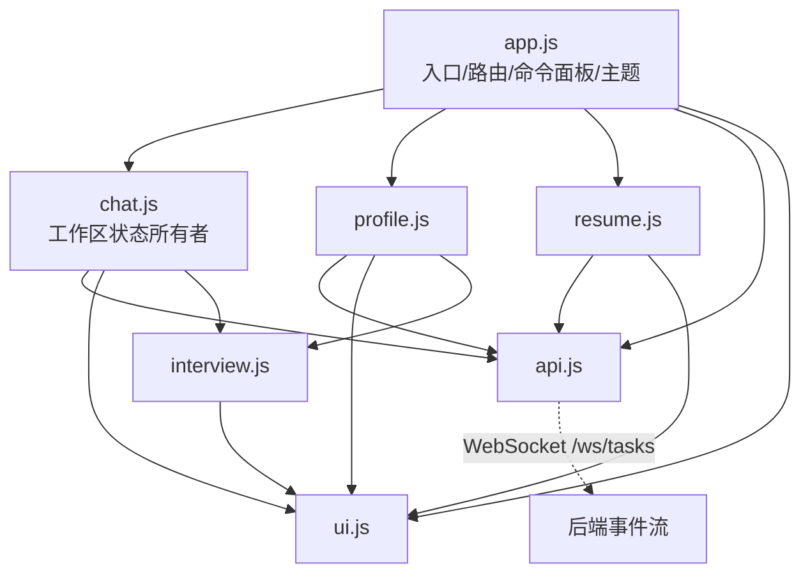
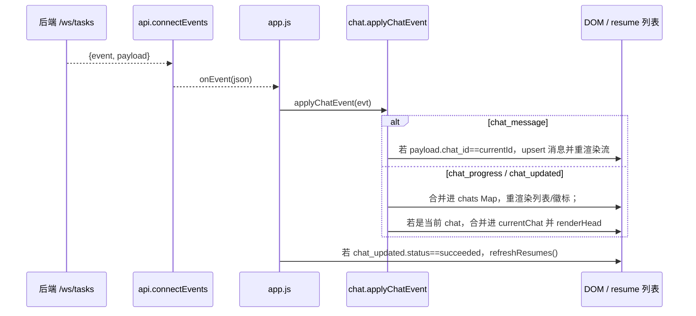

# 前端模块划分 / Frontend Modules

> **这篇讲什么**：7 个原生 ES Module 的职责与导出、模块依赖图与解耦方式、视图路由机制、WebSocket 事件如何收敛、无构建工具的取舍、静态资源版本号。
> **适合谁读**：要改前端交互、加新视图/组件、或排查「事件没更新 UI」的开发者。
>
> 权威来源：`backend/app/static/index.html`、`backend/app/static/js/*.js`、`backend/app/static/css/app.css`。

---

## 1. 技术约束

- **无构建工具**：浏览器直接加载 `<script type="module" src="/static/js/app.js?v=N">`，模块间用原生 `import` / `export`。
- **总规模**：`app.js ~659` + `chat.js ~845` + `resume.js 501` + `profile.js 379` + `interview.js 175` + `api.js 110` + `ui.js 55` ≈ **~2.7k 行 JS**（HTML ~559 行，CSS ~1128 行）。
- **视图**：`01 资料`（profile）/ `02 工作区`（workspace，默认）/ `03 简历`（resume）。

---

## 2. 模块职责与导出

| 模块 | 职责 | 关键导出 |
|---|---|---|
| **`app.js`** | 应用入口：视图路由、设置弹窗、命令面板（含「粘贴 URL 回车即抓取」）、全局快捷键、主题、启动编排 | 无导出（`boot()` 自执行） |
| **`api.js`** | REST 封装 `api.*` + WebSocket 订阅 | `api`（对象）、`connectEvents(onEvent)` |
| **`chat.js`** | **工作区状态所有者**：chats / currentChat / messages；WebSocket 事件收敛点；生成主流程；工作区粘贴简历解析 | `initChat`、`refreshChats`、`openChat`、`applyChatEvent` |
| **`profile.js`** | 资料库表单：可重复条目（REPEATERS）、头像、导入导出、AI 完善 | `initProfile` |
| **`resume.js`** | 简历工作台：WYSIWYG / 源码 / AI 修改 / 版式 / 匹配分析 / 打印导出 | `initResume`、`refreshResumes`、`openResume` |
| **`interview.js`** | AI 问答（flashcard）弹窗，资料页与工作区共用 | `openInterview(opts)` |
| **`ui.js`** | 通用 DOM 与 UI 工具 | `el`、`$`、`$$`、`toast`、`fmtTime`、`statusLabel`、`escapeHtml` |

### 2.1 `app.js` 关键点

- `switchView(name)`：切换 `.rail-item` 的 `is-active` / `aria-current`，切换 `.view.is-active`，进入 workspace/resume 时刷新，滚动归顶。
- **设置弹窗**：`openSettings` / `saveSettings` / `testConnection`；供应商预设缓存（`ensureProviders`）；模型下拉 + 「＋ 自定义模型名…」（`CUSTOM_MODEL_VALUE`）。
- **命令面板（Ctrl/Cmd+K）**：`baseCommands()` 在 app.js 内登记；`resumeCommands()` 动态拉最近 5 份简历。**刻意放在 app.js 注册，避免 chat.js / resume.js 与 app.js 循环依赖**；命令行为复用既有入口（`clickEl("#btn-new-chat")` / `switchView` / `openResume`）。
  - **粘贴 URL 即抓取（URL 模式）**：`#cmd-input` 的 `paste` 事件里，若剪贴板文本 `looksLikeUrl`（http(s):// 或裸域名、不含空白）→ `enterUrlMode()`：显示 `#cmd-url-hint`（「回车即抓取该链接」+ URL），`renderCommands("")` 只保留一条「导入该链接」命令。回车 → `runUrlImport` → `performUrlImport()` **复用既有从链接导入流程**（`switchView("workspace")` → 点 `#btn-import-url` → 填 `#import-url-input` → 点 `#btn-import-confirm`），不另写抓取逻辑。`Esc` 第一次只 `exitUrlMode()`（回普通模糊搜索），第二次才关面板。
- **快捷键**：`Ctrl/Cmd+K` 开关面板；`Ctrl/Cmd+S` 阻止浏览器保存网页（资料页触发保存）；`Ctrl/Cmd+Enter` 主操作。输入法组合中（`isComposing`）不触发。
- **主题**：`applyTheme(mode)` 写 `html[data-theme]` + localStorage（`arg.theme`）；跟随系统时监听 `matchMedia`。
- **启动 `boot()`**：绑定导航/设置 → `initProfile` → `initChat({openResume, switchView})` → `initResume(switchView)` → `connectEvents` → 首屏数据 → 简历列表 15s 定时兜底刷新。

### 2.2 `chat.js` 关键点

- **单一状态所有者**：`chats: Map`、`currentId`、`currentChat`、`messages`。WebSocket 事件在此收敛（`applyChatEvent`）。
- **composer 脏检测**：`savedTitle` / `savedReq` 作为「已持久化」基准，`composerDirty()` 判断是否需要 PATCH/POST、以及切换对话时是否确认放弃。
- **生成主流程 `generateChat()`**：保存有变化字段（title → PATCH，JD → POST message）→ `chatInterview` 取问题 → 无缺口直接 `startGenerate`；有缺口弹 flashcard（`openInterview`），提交走 `interview/submit`（`auto_generate=true`）。
- **耗时计时**：`genStartMs` + 每秒 `updateProgress`；基准优先 `started_at`。
- **`guessJobTitle`**：粘贴 JD 后本地启发式猜职位名回填（猜不到就留空，不硬填）。
- **工作区粘贴简历解析**：`document` 级 `paste` 监听（`onWorkspacePaste`）——**只在「工作区已打开对话」且粘贴目标不是职位名/岗位要求框（`#ws-title-input` / `#ws-input`）也不是 `#cmd-input` 时生效**；文本满足 `looksLikeResume`（长度 > 300 且含「工作经历/项目经历/教育背景/…」等章节词）才 `preventDefault` 并弹 `#resume-paste-dialog`。确认 → `confirmResumePaste` → `api.importChatProfileText`（`POST /{id}/profile/import-text`，只增补不覆盖，见 [reference.md](../03-api/reference.md#33-per-chat-资料快照)）。

### 2.3 `resume.js` 关键点

- **LAYOUTS / THEMES**：与后端 `resumes.py::VALID_LAYOUTS/VALID_THEMES`、`schemas.LayoutId/ThemeId` **必须保持一致**。
- **WYSIWYG**：`setEditorHtml` 把简历塞进 `<iframe srcdoc>` 并 `designMode="on"`；`getEditorHtml` 读回。
- **AI 修改**：`runAIEdit` 传 `current_html: getEditorHtml()`，成功后 `setEditorHtml(res.html)` 并刷新编辑历史。
- **匹配分析 `renderAnalysis`**：拉 `chat.job_analysis` + `renderCoverage(resume.coverage)`，渲染分节/关键词/硬性要求/技术栈/覆盖清单。

### 2.4 `interview.js` 关键点

- 回答存前端 `st.answers[]`，切卡不丢；`collect()` 只回传**填了内容**的回答。
- 三种收尾语义严格区分：**提交**（`onSubmit`）、**跳过全部**（`onSkip`，显式按钮）、**Esc/取消**（`onCancel`，不提交不生成）。

---

## 3. 模块依赖图



### 3.1 为什么避免循环依赖

- `profile.js` / `chat.js` 都需要弹 AI 问答 → 二者 import **`interview.js`**，而 `interview.js` 只依赖 `ui.js`，**不反向 import 调用方**（通过 `opts` 回调通信）。
- `chat.js` / `resume.js` 都需要「打开简历 / 切换视图」→ 由 `app.js` 通过 `initChat({openResume, switchView})` / `initResume(switchView)` **注入回调**，而不是互相 import。
- 命令面板放在 `app.js` 注册，正是为了**不引入 app.js ↔ chat.js 的反向依赖**。
- ⚠️ 若 `chat.js` 直接 `import { openResume } from "./resume.js"` 且 `resume.js` 又 import `chat.js`，模块图成环，原生 ESM 下会因初始化顺序问题拿到 `undefined`。

### 3.2 跨模块通信用什么

| 场景 | 方式 |
|---|---|
| 打开简历 / 切视图 | **回调注入**（`app.js` 传给 `initChat` / `initResume`） |
| 弹问答弹窗 | **模块 import + `opts` 回调**（`interview.openInterview`） |
| 后端 → UI 实时更新 | **WebSocket 事件**（`api.connectEvents` → `app.js` 转发 → `chat.applyChatEvent`） |
| 轻量提示 | `ui.toast` |
| 无全局事件总线 | 刻意不加 EventEmitter，保持数据流单向、可追踪 |

---

## 4. 视图路由机制

- 导航按钮：`<button class="rail-item" data-view="profile|workspace|resume">`。
- 视图区块：`<section class="view" data-view="profile|workspace|resume">`。
- 切换：`app.js::switchView(name)` → `$$(".rail-item")` 与 `$$(".view")` 分别 toggle `is-active`（CSS 只显示 `.view.is-active`）。
- 窄屏：`#workspace.is-chats-open` 控制是否展开对话列表（`btn-toggle-chats`）。

---

## 5. WebSocket 事件如何收敛到 `chat.js`



- `api.connectEvents` 负责**指数退避重连**（`retry` 上限 6，`500*retry` ms）。
- `chat.applyChatEvent` 用 `{...existing, ...payload}` 合并，因此**广播 payload 必须带 `progress`**（否则沿用旧值，见 [scheduler.md §4](../01-architecture/scheduler.md#4-状态机与不变式)）。
- 生成成功后 `openChat(id, {silent:true})` 补齐 `resume_id` 与完成消息。

---

## 6. 无构建工具的原因与代价

**原因**：
- 单机本地应用，用户双击 `start` 即用，不应要求 Node / npm / bundler。
- 原生 ESM 在目标浏览器（现代 Chromium/Edge）原生支持 `import`/`export`，~2500 行体量无需 tree-shaking。
- 零依赖树 = 零供应链风险、零 `node_modules`。

**代价**：
- 无 TS 类型检查、无 JSX、无自动前缀、无热更新。
- 需手动维护 `?v=N` 版本号破缓存。
- 模块间靠约定解耦（回调注入 / 事件），没有框架的路由与状态管理。

---

## 7. 静态资源版本号 `?v=N`

`index.html` 中：

```html
<link rel="stylesheet" href="/static/css/app.css?v=10" />
<script type="module" src="/static/js/app.js?v=10"></script>
```

- **作用**：浏览器对 `/static/...` 有强缓存；改前端后若不提升 `?v=N`，用户会继续用旧文件。
- **规则**：**改前端后必须提升版本号**（当前为 `v=10`）。改 CSS 也要升（因为 CSS 也带 `?v`）。
- ⚠️ 只改了 JS 但没改 HTML 里的 `?v=N` → 缓存依旧命中，改动不生效。

---

## 8. 常见陷阱

1. **`?v=N` 忘了提升**：最常见的「我明明改了怎么没效果」。改任何 `/static` 下的文件都要升。
2. **循环依赖**：新增跨模块调用时优先用**回调注入**或 **import 无反向依赖的工具模块**，别让两个业务模块互相 import。
3. **`isComposing` 守卫**：中文输入法组合期间不要触发快捷键（`Ctrl+Enter` 等），`app.js` 与 `chat.js` 都做了 `isComposing` / `keyCode===229` 判断。
4. **WebSocket 事件名 vs 路径**：事件名是 `chat_*`，但路径仍是 `/ws/tasks`（历史兼容），两者不一致，别按名字去找路径。
5. **`LAYOUTS`/`THEMES` 三处必须同步**：`resume.js`、`resumes.py::VALID_*`、`schemas.LayoutId/ThemeId`。改一处而漏另一处会导致「前端能选、后端 400」。

---

**相关文档**：[系统总览](../01-architecture/overview.md) · [设计系统](./design-system.md) · [API 参考](../03-api/reference.md)
