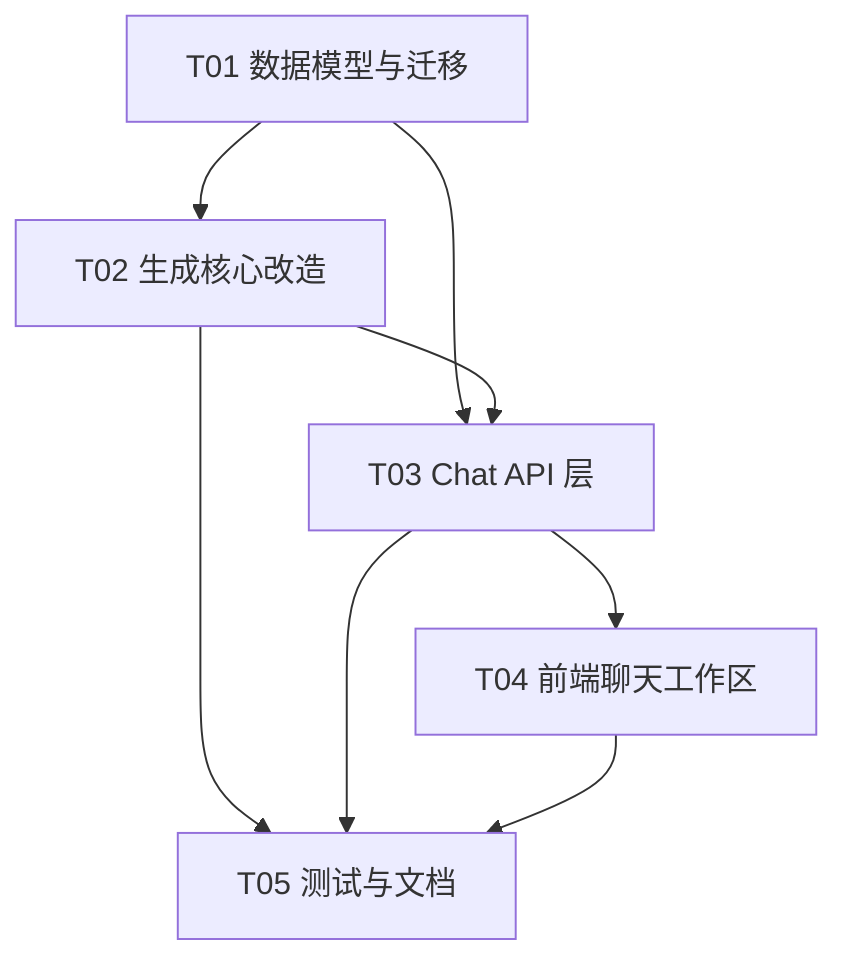

# 增量重构设计：岗位批量生成 → 聊天式工作区

> 目标：把「粘贴一大段 → 批量建 N 个任务 → N 份简历」的模型，改为「一个 chat = 一份简历」的聊天式工作区。
> 本文件为**增量设计**（基于现有 `backend/app` 实现），不含实现代码。

## 1. 重构范围与影响面

### 1.1 文件级改动

| 文件 | 动作 | 说明 |
|---|---|---|
| `app/models.py` | 改 | 新增 `Chat`（由 `JobTask` 演进）、`ChatMessage`；`Resume.task_id`→`chat_id`；去掉 `JobTask.resume_id` 反向引用 |
| `app/schemas.py` | 改 | 新增 `ChatIn/ChatPatch/ChatOut/ChatMessageIn/ChatMessageOut/CoverageItem`；`ResumeOut` 增 `coverage` |
| `app/migrate.py` | **新增** | 幂等迁移：`jobtask`→`chat`、`resume.task_id`→`chat_id` |
| `app/db.py` | 改 | `init_db()` 末尾调用 `migrate.run()` |
| `app/prompts.py` | 改 | 岗位分节解析 + 覆盖清单契约 + 防编造硬规则（见 §5） |
| `app/pipeline.py` | 改 | `run_task`→`run_chat`：入参 `chat_id`；用 `Chat.profile_snapshot`；产出 `coverage` |
| `app/mock.py` | 改 | `analyze_job` 支持分节标题识别；`generate_spec` 产出启发式 `coverage` |
| `app/scheduler.py` | 改 | `JobTask`→`Chat`（机械替换）；事件名 `task_*`→`chat_*` |
| `app/events.py` | 改 | 事件语义：`chat_message`/`chat_progress`/`chat_updated` |
| `app/renderer.py` | 小改 | 无结构变化；仅确保 `coverage` 不进入正文渲染 |
| `app/routers/chats.py` | **新增** | Chat CRUD + 资料快照 + 消息 + generate/cancel/retry |
| `app/routers/tasks.py` | 改 | **降级为兼容层**（见 §1.3），内部映射到 Chat |
| `app/routers/resumes.py` | 小改 | `task_id`→`chat_id`；`ResumeOut` 带 `coverage` |
| `app/main.py` | 改 | 挂载 `chats.router` |
| `app/static/index.html` | 改 | 移除「岗位」「任务」视图；新增「工作区」聊天视图 |
| `app/static/js/chat.js` | **新增** | 聊天工作区（列表 + 对话 + 资料快照 + 生成） |
| `app/static/js/app.js` | 改 | 路由改为 资料/工作区/简历；事件分发到 `applyChatEvent` |
| `app/static/js/api.js` | 改 | 新增 chat 系列接口 |
| `app/static/js/resume.js` | 改 | 「匹配分析」tab 渲染覆盖清单（grounded/capability 徽章） |
| `app/static/js/jobs.js` | **删** | 批量切分逻辑废弃 |
| `app/static/js/tasks.js` | **删** | 看板废弃；事件处理迁入 `chat.js` |
| `app/static/css/app.css` | 改 | 新增聊天布局样式（左列表/右对话/气泡/进度） |

### 1.2 复用（不改动核心逻辑）
`llm.py` / `providers.py` / `sanitize.py` / `settings` 路由 / `renderer` 的 5 版式渲染 —— **全部保持**，降低风险。

### 1.3 现有 7 个测试脚本影响

| 测试 | 影响 | 处理建议 |
|---|---|---|
| `regression.py`（160 项） | `from app.models import JobTask` + 2 处直接构造 | 改为 `Chat`；HTTP 层走兼容层 `/api/tasks` 可**零改动** |
| `smoke.py` | 用 `/api/tasks/batch` | 兼容层保留 `/api/tasks/batch` → 映射为「每个 job 建一个 chat」；或改走 `/api/chats` |
| `progress_probe.py` | 用 `/api/tasks` + 空资料失败 | 兼容层兜底，零改动 |
| `e2e_verify.py` | 用 `/api/tasks` 建简历 | 兼容层兜底，零改动（版本几何/CSP 与业务模型无关） |
| `xss_probe.py` | 用 `/api/tasks` + `/api/resumes` | 兼容层兜底，零改动 |
| `settings_ui_check.py` | 仅设置弹窗 | **不受影响** |
| `ui_check.py` | 依赖 `data-view="jobs"/"tasks"`、`#job-raw`、`#btn-split` | **必然失效**，重写为 `chat_ui_check.py`（新建 chat→贴 JD→生成→打开简历→各 tab） |

> **策略**：保留 `/api/tasks` 兼容路由（deprecated，标 `deprecated=True`），让 5 个 HTTP 级测试继续充当「调度器/重试/取消/渲染/净化」的安全网——这些恰恰是本次**不重构**的部分。等新聊天链路稳定后再决定是否下线兼容层。

## 2. 数据模型设计

### 2.1 关键决策

- **`JobTask` → `Chat`（重命名 + 扩展）**，而非新建并行表。理由：调度器（`asyncio.Queue`+worker+条件 UPDATE 抢占+重启恢复）完全以 `JobTask.id` 为键，重命名是机械替换，能 100% 复用经过回归验证的并发/重试/取消逻辑；新建表等于重写调度器，风险过高。
- **per-chat 资料 = 整体快照（full snapshot）**，不采用增量 diff。理由：①diff 合并语义易错且反直觉（全局后续改动谁赢？）；②chat 是「冻结的工作上下文」，数月后复现同一份简历必须用当时的资料；③「重置回全局」退化为一次深拷贝，实现最简单。存 `Chat.profile_snapshot`（JSON，Profile 去掉 id/时间戳的形状）。
- **`Resume` 关联收敛为单向**：只保留 `Resume.chat_id`（FK），**删除 `Chat.resume_id`**。理由：一 chat 一简历是 1:1；现有双向引用正是 `tasks.py`/`resumes.py` 删除逻辑里「先置空 resume_id 再删」那套绕外键代码的根源。单向后删除干净。Chat 列表所需的 `resume_id` 由查询派生（左连 Resume），非存储字段。
- **消息模型新建 `ChatMessage`**，不复用 `EditLog`。理由：`EditLog` 是「对简历 HTML 的 AI 二次编辑」（含 before/after_html），语义与「对话消息」正交；混用会让两者都变脏。
- **`coverage` 存在 `Resume` 上**（JSON 列），不放 `Chat`。理由：覆盖清单是「这份简历」的属性，随简历版本走；`Chat.job_analysis` 只保留 requirements/分节/employer_questions。

### 2.2 表结构（新增/变更字段）

**`Chat`**：`id, title, status(queued/running/succeeded/failed/cancelled/draft), stage, progress, error, attempts, max_retries, raw_text, source, source_url, profile_snapshot(JSON), profile_dirty(bool), job_analysis(JSON), created_at, updated_at, started_at, finished_at`
**`ChatMessage`**：`id, chat_id(FK), role(user/assistant/system), kind(jd/text/notice/guidance), content(Text), meta(JSON), created_at`
**`Resume`**：`task_id` → **`chat_id`(FK,index)**；新增 `coverage(JSON)`；其余不变。
**`EditLog`**：不变（仍挂 `resume_id`）。

类图见 `docs/class-diagram.mermaid`。

### 2.3 迁移策略（明确建议）

**建议：写幂等迁移脚本 `app/migrate.py`，在 `init_db()` 中执行**，而非直接删库。
- 理由：用户已在使用，库里可能已有想保留的简历；删库不可逆。迁移成本很低。
- 步骤：①若存在旧表 `jobtask` 且新表 `chat` 为空 → 建 `chat`；②每行 `jobtask` → 一个 `Chat`（`title/raw_text/status/progress/stage/attempts/error` 直搬；`profile_snapshot` = 迁移时点的全局 `Profile` 深拷贝；补一条 `ChatMessage(kind=jd)`）；③`resume.task_id` 复制到 `resume.chat_id`；④丢弃旧 `jobtask` 表。
- 兜底：脚本开头检测「无旧数据」则直接 return；提供 `python -m app.migrate --fresh` 供想彻底重建的用户。

## 3. 接口设计

| 方法 | 路径 | 状态 | 入参 | 出参 / 错误 |
|---|---|---|---|---|
| POST | `/api/chats` | 新增 | `{title?}` | `ChatOut`（含快照、派生 resume_id）；创建时快照全局 Profile |
| GET | `/api/chats` | 新增 | `?limit` | `[ChatOut]` |
| GET | `/api/chats/{id}` | 新增 | — | `ChatOut` + `messages[]`；404 |
| PATCH | `/api/chats/{id}` | 新增 | `{title?}` | `ChatOut`；404 |
| DELETE | `/api/chats/{id}` | 新增 | — | 204（级联删 Resume+EditLog+ChatMessage）；运行中→400 |
| GET | `/api/chats/{id}/profile` | 新增 | — | `ProfileOut`（快照） |
| PUT | `/api/chats/{id}/profile` | 新增 | `ProfileIn` | `ChatOut`；置 `profile_dirty=true`（不改全局） |
| POST | `/api/chats/{id}/profile/reset` | 新增 | — | 快照重置为全局；`profile_dirty=false` |
| POST | `/api/chats/{id}/messages` | 新增 | `{kind, content}` | `ChatMessageOut`（201） |
| GET | `/api/chats/{id}/messages` | 新增 | — | `[ChatMessageOut]` |
| POST | `/api/chats/{id}/generate` | 新增 | — | 入队，202/`ChatOut`；无 JD→400；已 running→409 |
| POST | `/api/chats/{id}/cancel` | 新增 | — | `ChatOut` |
| POST | `/api/chats/{id}/retry` | 新增 | — | `ChatOut`；running/queued→409 |
| GET | `/api/chats/{id}/coverage` | 新增 | — | `{coverage:[CoverageItem], summary:{...}}`；未生成→404 |
| — | `/api/resumes/*` | 修改 | — | 内部 `task_id`→`chat_id`；`ResumeOut` 增 `coverage` |
| — | `/api/tasks*` | **废弃(兼容)** | 同旧 | 内部映射到 Chat，保证旧测试通过 |
| — | `/api/tasks/batch` | **废弃(兼容)** | 同旧 | 每个 job 建一个 Chat 并逐个入队 |

统一错误约定沿用现状：`HTTPException(status, 中文 detail)`；`api.js` 用 `err.status` 区分 409。

## 4. 生成流程时序

复用现有 WebSocket（`/ws/tasks`，路径名保留以免前端大改），事件改名 `chat_message`/`chat_progress`/`chat_updated`，payload 带 `chat_id`。

时序图见 `docs/sequence-diagram.mermaid`。要点：
1. 用户在 chat 内贴 JD → `POST /messages` → 落 `ChatMessage(jd)` + 写 `Chat.raw_text` → 广播 `chat_message`。
2. 点「生成」→ `POST /generate` → 校验（有 JD、未运行）→ `scheduler.enqueue(chat_id)`。
3. worker 抢占（条件 UPDATE）→ `run_chat`：载入 `profile_snapshot` → 解析岗位（含分节 + employer_questions 剔除）→ 生成 spec + coverage → 渲染 HTML → 落 Resume（含 coverage）→ `Chat.status=succeeded`。
4. 每阶段 `hub.broadcast("chat_progress", {chat_id, progress, stage})`；完成广播 `chat_updated` + 一条 `ChatMessage(notice)`。
5. 前端 chat.js 收到事件 → 更新状态 → 重渲染对话区与进度；完成后显示「查看简历 / 查看覆盖清单」。

## 5. 提示词改造要点（`prompts.py`）

### 5.1 岗位解析（SYSTEM_ANALYZE）
- 增加**分节识别**：`Responsibilities/Requirements/Qualifications/About the role/Job Description/Working Terms/Benefits/Skills/Employer questions` 及中文对应（岗位职责/任职要求/任职资格/工作职责/福利/技能要求/申请问题）。输出 `sections:[{heading, kind, items[]}]`。
- 增加**扁平化需求列表** `requirements:[{id:"R1", kind:"must_have|responsibility|nice_to_have", text, section}]`（id 供覆盖清单引用）。
- **`employer_questions` 单独字段**：申请表元数据，**排除在简历正文外**，仅供前端展示。
- 容错：格式混乱时按 bullet/短句兜底切分（同步改进 `mock.analyze_job` 的启发式）。

### 5.2 内容生成（SYSTEM_GENERATE）—— 化解「覆盖度 vs 不编造」张力
新增硬规则：
1. **必须覆盖 `requirements` 中每一条**（`responsibilities` 也要覆盖）；无法映射时也必须给出 `capability` 表述，不得留空。
2. 每条需求产出覆盖项，`source` 仅两档：
   - `grounded`：来自资料真实经历，**必须**填 `evidence_ref`（指向 experiences/projects/skills 的具体项）。
   - `capability`：资料无直接对应，只可写「具备…能力/意向/可快速上手…」，**严禁**编造公司名、年限、项目名、数字、学历、证书。
3. 生成前自查：任何具体可证伪事实（公司/时间/数字/学历）必须能在资料中溯源，否则降级为 `capability`。
4. 输出新增 `coverage` 数组（契约见下）。

### 5.3 覆盖清单 JSON 结构
```json
{
  "coverage": [
    { "req_id": "R1",
      "requirement": "3 年以上 Python 后端开发经验",
      "section": "Requirements",
      "resume_evidence": "工作经历·ACME：5 年 Python 后端，主导订单链路重构",
      "source": "grounded",          // grounded | capability
      "evidence_ref": "experiences[0].achievements[0]",
      "note": "" }
  ],
  "summary": { "total": 8, "grounded": 6, "capability": 2, "uncovered": 0 }
}
```
`_normalize_spec` 需新增对 `coverage` 的收敛（缺失字段补默认、`source` 白名单收敛为 grounded/capability）。

## 6. 前端信息架构（原生 ESM）

- **导航（rail）**：`01 资料`（全局 Profile，保留）、`02 工作区`（新增，默认页）、`03 简历`（Studio，保留）。删除 `岗位`、`任务`。
- **工作区视图布局**（CSS grid 两栏）：
  - 左 `chat-list`：`＋新建对话` + 会话列表（标题、状态徽章、更新时间）。
  - 右 `chat-pane`：`chat-header`（标题 / 状态 chip / 资料条「全局快照 · 已修改 · 编辑 · 重置」）→ `message-stream`（气泡：user_jd / system / assistant / notice；生成中内嵌进度条）→ `composer`（贴 JD 或输入 + `生成简历` / `取消` / `重试`；完成后 `查看简历` / `查看覆盖清单`）。
- **状态管理（无框架，避免混乱）**：`chat.js` 作为工作区**唯一状态所有者**（单一 `state = {chats:Map, activeId, messages:[], profile}` + 纯 `render*()` 函数），与旧 `tasks.js` 同构。事件流：WS → `applyChatEvent(evt)` 改 state → 局部重渲染（按 `data-chat-id` 定位替换）。跨视图不共享可变状态，只经 `api.js` 通信。
- **与 `resume.js` 衔接**：`查看简历` 调用既有 `openResume(resumeId)` 并 `switchView("resume")`（复用现成机制）；覆盖清单在 Studio 的「匹配分析」tab 内渲染（`ResumeOut.coverage`），徽章：`grounded`=绿、`capability`=青/灰并附「能力表述，非具体事实」提示。

## 7. 任务列表（有序，≤5）

| ID | 任务 | 涉及文件 | 依赖 | 优先级 |
|---|---|---|---|---|
| T01 | **数据模型与迁移基础**：新增 `Chat`/`ChatMessage`，`Resume.chat_id`+`coverage`，去双向引用；schema；幂等迁移 | `models.py, schemas.py, migrate.py, db.py` | — | P0 |
| T02 | **生成核心改造**：分节解析 + 覆盖清单契约 + 防编造规则；`run_chat` 用快照产出 coverage；mock 同步 | `prompts.py, pipeline.py, mock.py, scheduler.py, renderer.py` | T01 | P0 |
| T03 | **Chat API 层**：chats 路由（CRUD/快照/消息/generate/cancel/retry/coverage）；`/api/tasks` 兼容层；事件改名；挂载 | `routers/chats.py, routers/tasks.py, routers/resumes.py, main.py, events.py` | T01,T02 | P0 |
| T04 | **前端聊天式工作区**：导航改造、聊天视图、api 扩展、删除 jobs/tasks；Studio 覆盖清单展示；样式 | `static/index.html, js/app.js, js/api.js, js/chat.js, js/resume.js, css/app.css`（删 `js/jobs.js, js/tasks.js`） | T03 | P0 |
| T05 | **测试与文档**：更新 regression/smoke（import/接口），新增 `chat_ui_check.py` 替代 `ui_check.py`，更新 README | `tests/regression.py, tests/smoke.py, tests/chat_ui_check.py, README.md` | T02,T03,T04 | P1 |

依赖图见文末。

## 8. 风险与待确认事项

1. **一 chat 一简历 + 重新生成**：若已有简历再次点「生成」，是**覆盖**（删旧建新）还是**保留版本历史**？建议默认覆盖（契合「一个 chat 一个简历」），待用户确认。
2. **`capability` 仍可能被读成编造**：靠提示词硬约束 + 前端显式徽章「能力表述·非具体事实」双重缓解；上线后需抽查生成质量。
3. **兼容层 `/api/tasks` 的去留**：短期保留以保 7 测试绿；长期应在测试迁移完成后下线，避免双模型维护成本。
4. **迁移的 `profile_snapshot` 取值时点**：旧任务迁移时用「迁移当刻的全局资料」，可能与原始生成时不一致（旧库未存快照）——可接受，需在迁移日志中说明。
5. **WS 路径仍叫 `/ws/tasks`**：纯命名遗留，建议本轮不动（降风险），后续可加 `/ws/events` 别名。
6. **`employer_questions` 的展示位置**：是否需要在 chat 内以独立卡片展示给用户（当前设计：存 `job_analysis`，前端可折叠展示）。
7. **`Chat.title` 来源**：新建时默认「新对话」，首次生成后用解析出的 `job_title` 自动命名（沿用现有 `pipeline` 逻辑）。
8. **删除 chat 是否连带删简历**：建议级联（一 chat 一单元）；与旧「删任务级联删简历」语义一致。

## 9. 任务依赖图


